# AI-assisted Design workflow 中 Perceived Effect 评价实践：RQ1–RQ3 修订后研究报告

## 1. 研究对象、分析单位与数据结构

本研究纳入 **125 篇全文论文**，识别 **158 个评价案例**，拆解为 **490 条评价证据链**。评价证据链以“效果主张／评价问题→感知构念→主观指标→测量工具”为结构。规范性审查、RQ1的维度与指标统计以及RQ3的链级建模均以证据链为基本单位。

490条证据链进一步拆出 **600 个测量工具实例**。原因是一条证据链可能同时使用量表、访谈或问卷等多个工具。每个工具实例只归入一个互斥类别：M1标准化具名量表、M2自编结构化评分工具、M3定性言语引出工具、M4非量表型结构化问卷、M5既有感知资料分析。共584个实例可判定类别，16个因原文信息不足保留为UNMAPPED。

该划分借用CDC“Gather Credible Evidence”中从评价问题、概念到指标和测量的证据形成逻辑。JCSEE第三版用于构造**JCSEE启发的、基于公开论文文本的评价证据链报告充分性与方法适切性检查项**；本研究只纳入可由论文判断且直接相关的U5、A2、A3、A4、A6、A7和E1，并未实施30项标准的完整合规认证。质量层级、子规则和M1–M5均为本研究操作化，不是CDC或JCSEE发布的官方分类或总分。详细规则与未纳入标准见《AI辅助设计感知效应_问题答复与补充分析》。

- CDC证据形成框架：https://www.cdc.gov/evaluation/php/evaluation-framework-action-guide/step-4-gather-credible-evidence.html
- JCSEE项目评价标准：https://evaluationstandards.org/program/

## 2. RQ1：评价证据的分布

### 2.1 评价维度的总体分布与年代趋势

| 维度 | 证据链数 | 占已映射维度证据链 |
|---|---:|---:|
| A 设计成果质量 | 136 | 31.481% |
| B 设计过程质量 | 41 | 9.491% |
| C 设计者认知、情感与能力 | 101 | 23.380% |
| D 人机交互体验 | 91 | 21.065% |
| E 社会情境价值 | 63 | 14.583% |

五类计数的分母为432条已映射维度证据链，显示比例保留三位小数后合计100.000%。设计成果质量是现有研究最常评价的维度，其后依次为设计者认知、情感与能力、人机交互体验、社会情境价值和设计过程质量。年度数量在2024年后明显上升，反映的是本语料库的发表结构；因此趋势判断同时查看数量和当年构成比。二项GLM的年度构成检验显示，C类和D类占比出现统计下降，但效应较小：C类每年优势比0.949（BH校正q=.050），D类0.983（q=.025）。A、B、E的校正后趋势没有达到.05。

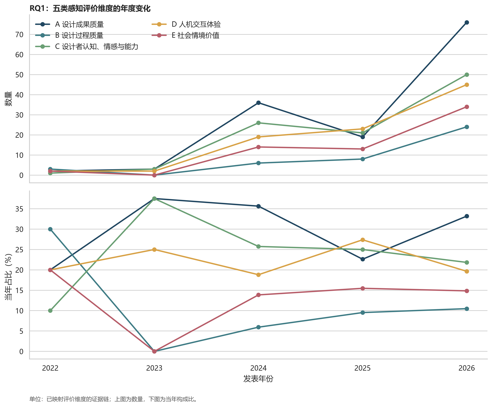

### 2.2 主观指标的分布与年代趋势

| 排名 | 指标 | 证据链数 |
|---:|---|---:|
| 1 | A3 适用性 | 36 |
| 2 | A1 新颖性 | 32 |
| 3 | C5 愉悦 | 28 |
| 4 | D8 沟通、协调、冲突与共同理解 | 24 |
| 5 | A4 可行性 | 23 |
| 6 | A2 美观性 | 20 |
| 7 | D3 控制感 | 20 |
| 8 | C1 灵感刺激 | 18 |
| 9 | C2 知识获得 | 18 |
| 10 | E2 用户需求、情境与人群适配 | 17 |
| 11 | D1 易用性 | 16 |
| 12 | B5 过程连续性 | 14 |

高频指标集中在适用性、新颖性、愉悦、沟通协作、可行性、美观性和控制感。指标级趋势比维度级趋势更具体，但部分指标总量很少，容易产生完全分离或极端年度比值。因而报告只把总量不少于10且优势比有限的结果作为稳定描述。增长较明确的指标包括能力扩展（每年OR=1.290）、知识获得（1.276）、商业／品牌／市场价值（1.231）、美观性（1.143）、工作负荷（1.105）与角色／贡献公平（1.105）；下降较明确的包括灵感刺激（0.618）、控制感（0.843）、愉悦（0.868）、沟通协作（0.909）和全面性（0.912）。这些结果描述文献选择的变化，不表示真实设计效应随年代发生同样变化。

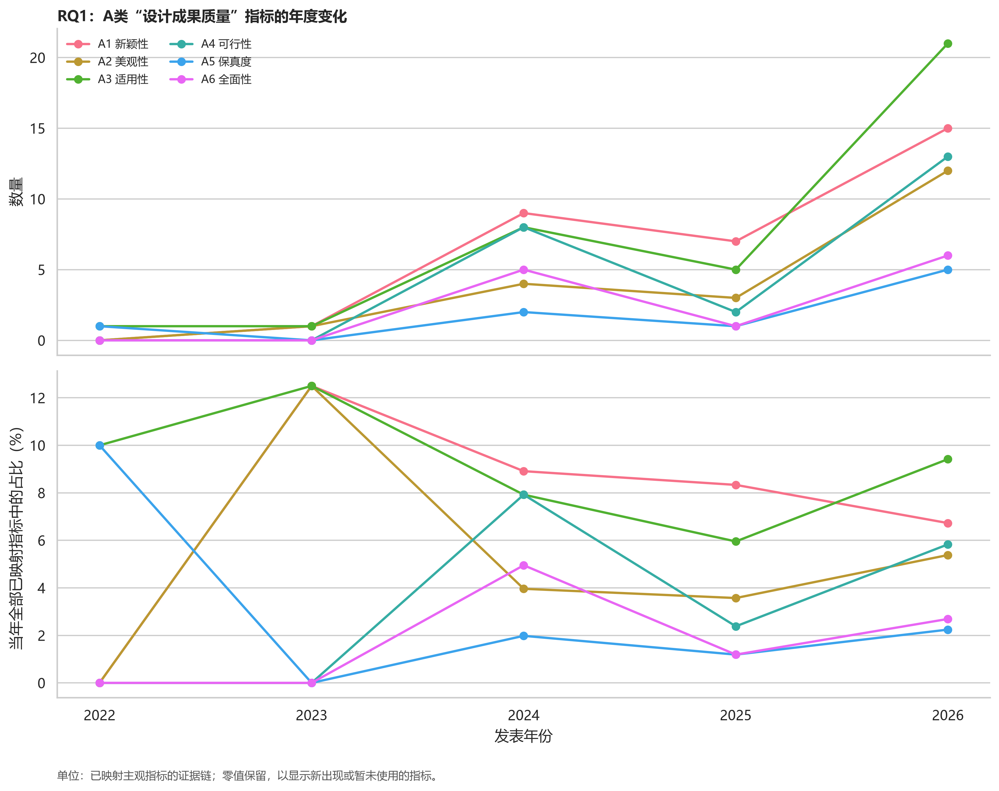

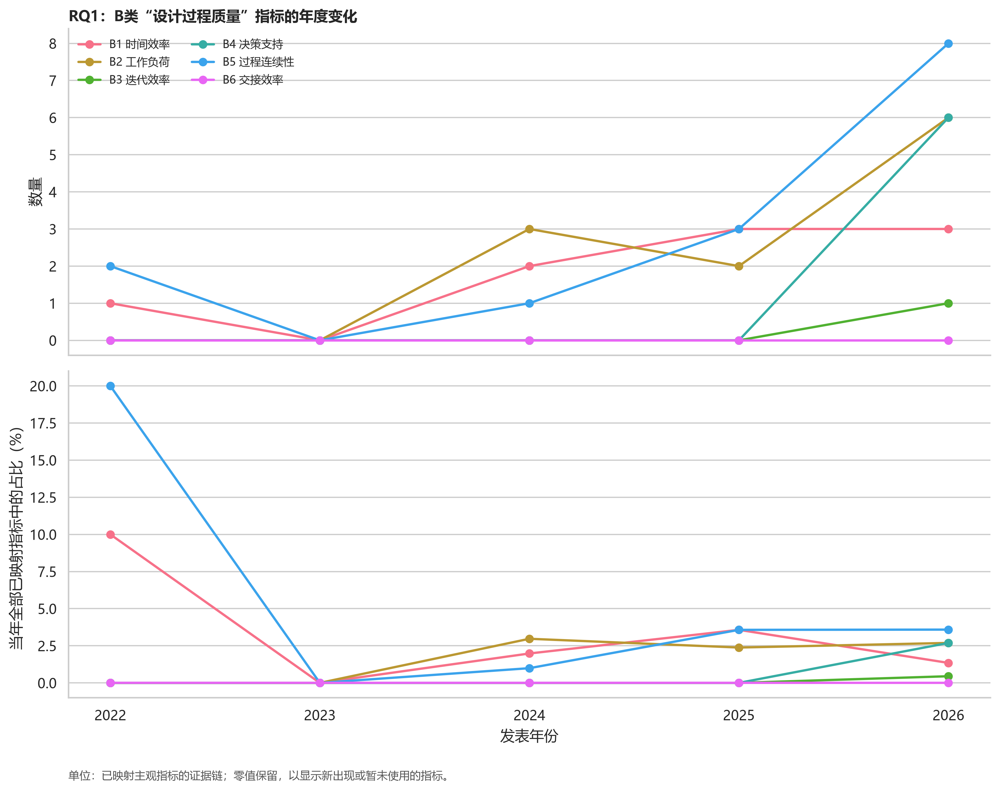

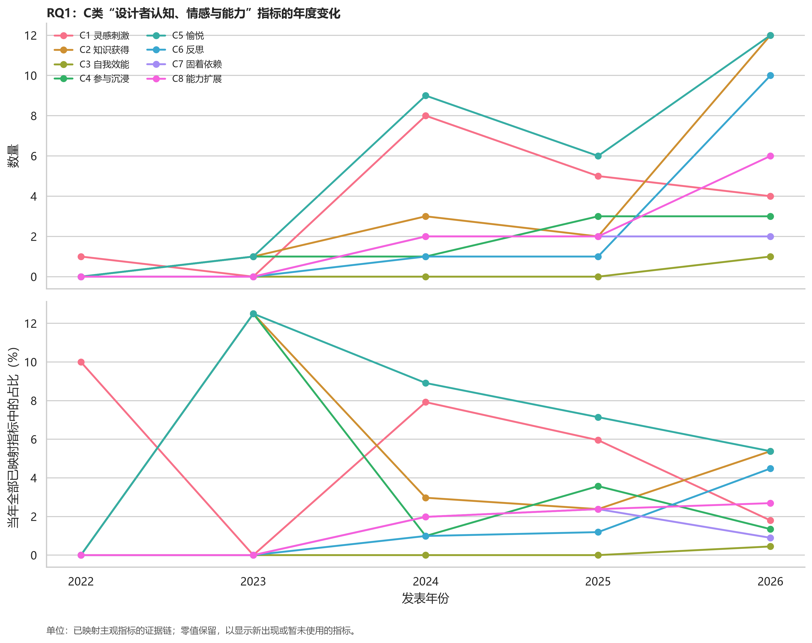

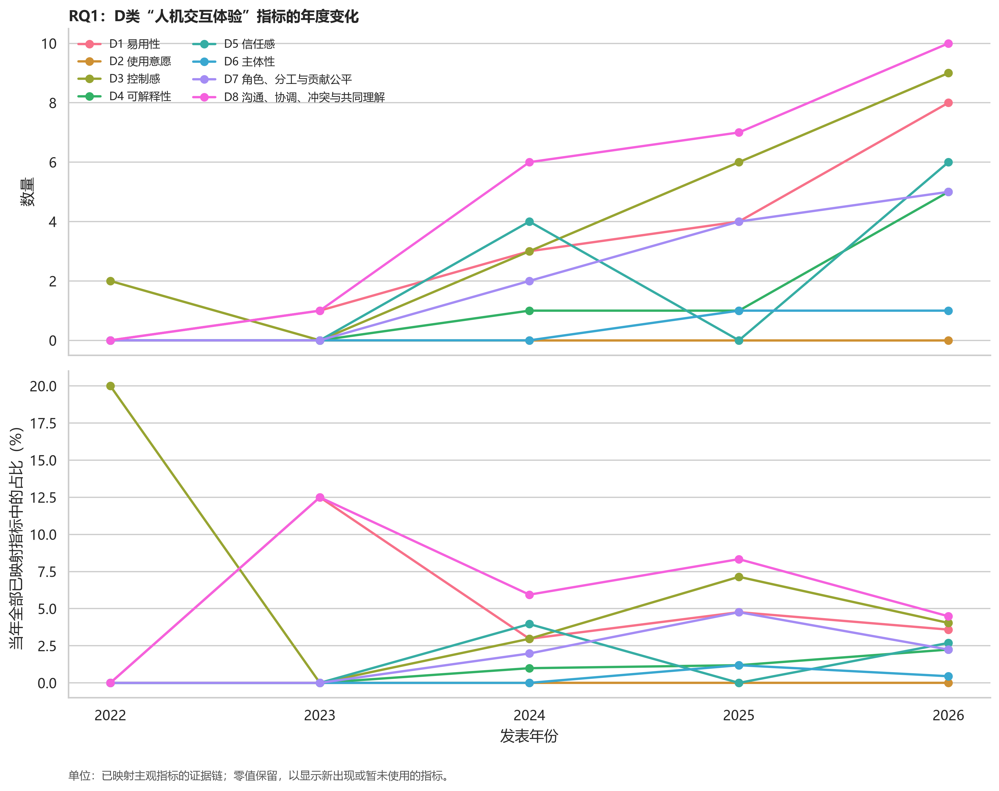

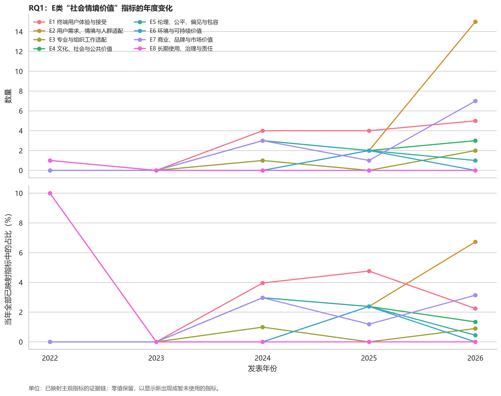

### 2.3 测量工具的总体分布与年代趋势

| 工具类别 | 工具实例数 | 占可判定工具实例 |
|---|---:|---:|
| M1 标准化具名量表 | 97 | 16.6% |
| M2 自编结构化评分工具 | 180 | 30.8% |
| M3 定性言语引出工具 | 130 | 22.3% |
| M4 非量表型结构化问卷 | 112 | 19.2% |
| M5 既有感知资料分析 | 65 | 11.1% |

M2自编结构化评分是最常见工具，2026年达到当年可判定实例的37.3%。年度构成检验显示M2上升（每年OR=1.336），M1、M3和M5下降（分别为0.854、0.861和0.914）；M4没有稳定单调趋势。该结果说明研究正在更多依赖面向具体系统或设计任务的自编评分，也提示跨研究可比性可能继续下降。

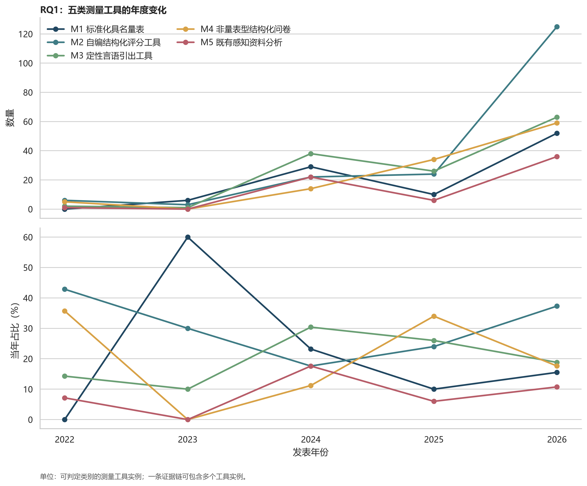

### 2.4 评价维度在设计领域和设计阶段中的分布

设计领域×评价维度的总体独立性检验为χ²(20)=27.54, p=0.121, Cramér’s V=0.112；设计阶段×评价维度为χ²(12)=13.20, p=0.355, V=0.066。两者均未达到统计显著，效应量也小。因此不能把设计领域或阶段单独当作决定评价维度的充分依据。领域和阶段仍适合作为推荐系统的情境筛选标签，但需要与评价对象、数据源、目的和主体联合使用。

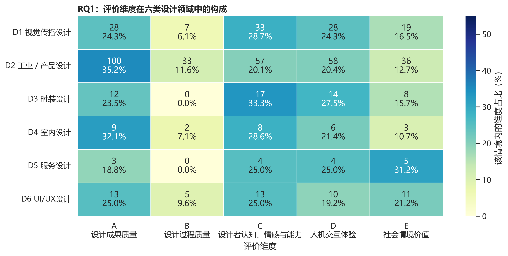

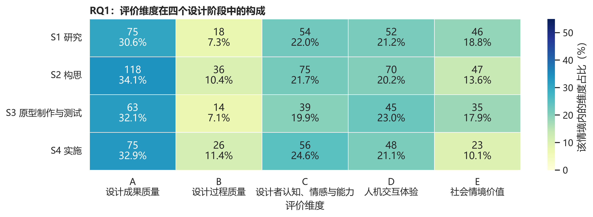

### 2.5 主观指标和测量工具在设计领域与设计阶段中的分布

补充分析采用情境内构成比热图，格内标注原始计数。主观指标×设计领域和主观指标×设计阶段的总体差异均不稳定；指标×领域χ²(165)=175.86, p=.267, V=.255，指标×阶段χ²(99)=73.58, p=.974, V=.156。由于相应表中84.8%和41.2%的期望频数小于5，且一条链可被展开到多个领域或阶段，这两个p值只作探索性描述。

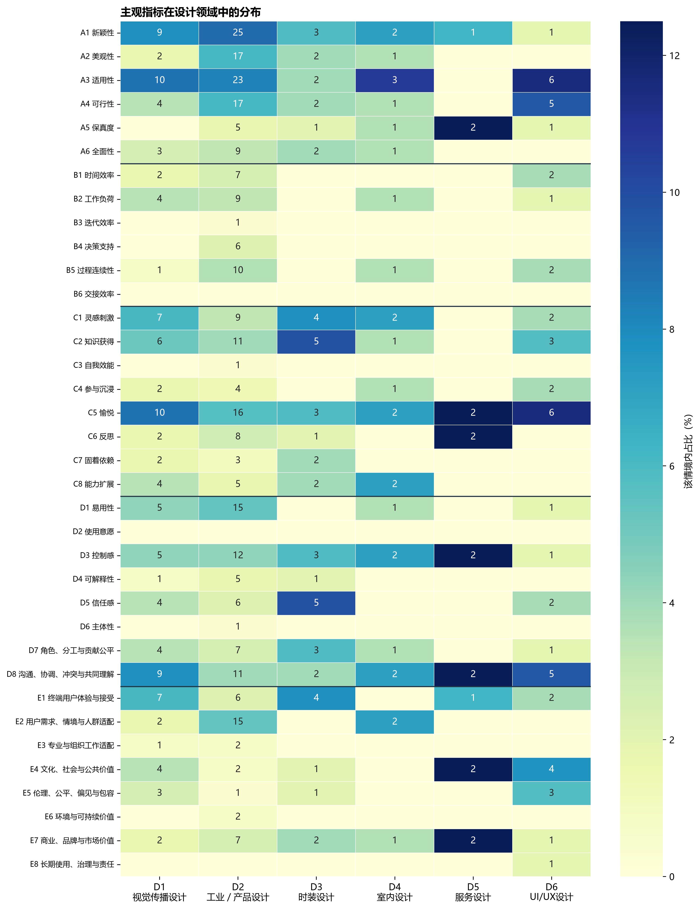

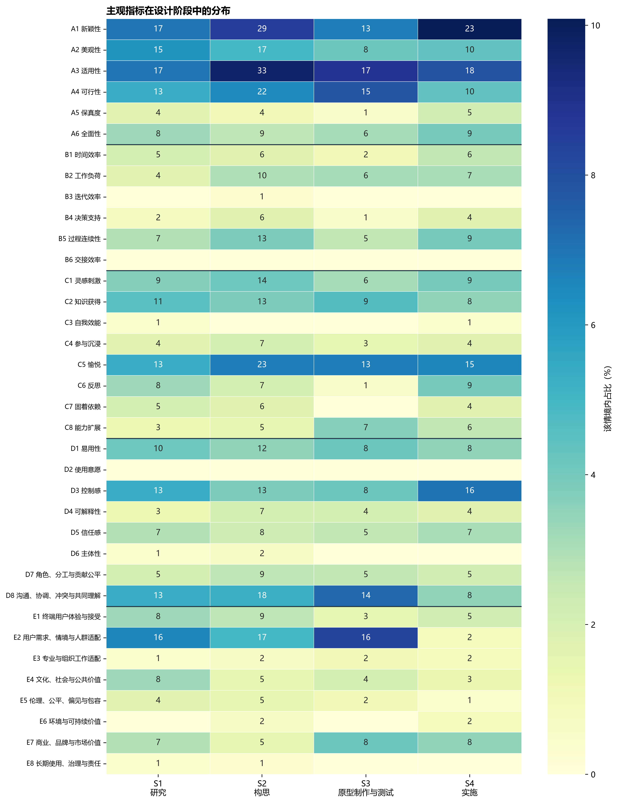

测量工具的领域差异较明显，χ²(20)=260.66, p<.001, V=.300；阶段差异较弱，χ²(12)=50.31, p<.001, V=.110。工业／产品设计更多使用M2，时装设计集中于M3和M2，室内设计集中于M4和M3，服务设计与UI/UX设计中M5占比较高。各阶段均以M2居首，原型制作与测试阶段M4占比相对较高。结果描述本语料中的方法选择，不能解释为领域或阶段对工具选择的因果作用。

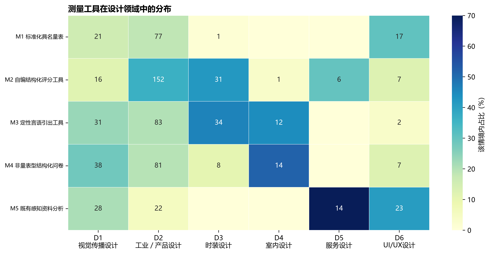

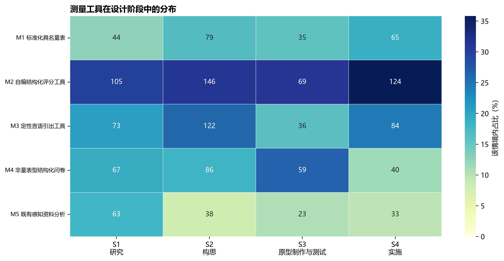

## 3. RQ2：评价实践的规范性审查

### 3.1 审查步骤

1. **确定审查单位。** 每条效果主张—构念—指标—测量工具链视为一次评价实践；同一案例中的不同感知效应分别审查。
2. **选择可由论文文本判断的JCSEE条目。** 使用U5、A2、A3、A4、A6、A7和E1，覆盖用途相关性、效度、可靠性、情境描述、设计分析、推理可追溯和记录充分性。选择条件是与证据链直接相关、能由公开论文定位、能落到链或所属案例；其余23项需要管理、协商、伦理治理、资源或元评价材料，不进入链级质量层级。
3. **把标准转为可观察规则。** 例如A2查找量表来源、题项、理论依据、预测试或效度证据；A3查找内部一致性、评分者一致性、编码一致性、三角互证等；A6与A7把主张类型、比较条件、分析方法和结果引文连起来判断。
4. **逐链记录状态与依据。** 每一条链保留S充分支持、P部分支持、NR未报告／无法判断、C明确问题或NA不适用，同时记录事实、理由、页码和短引文。共形成3,430条标准—证据链审查记录。
5. **形成研究用途层级。** Q1要求核心条目充分；Q2允许部分支持；Q3保留为描述或敏感性分析；发现明确问题者进入EXCLUDE。层级用于透明选样，不被解释为JCSEE官方总分。
6. **建立建模输入。** 主要规范集为Q1+Q2共48条链；扩展规范集共155条链，要求U5、A2、A4、A6、A7和E1至少S/P、任何标准无C，但允许A3为NR。这里A3=NR表示可靠性／可信性依据未报告、无法判断，只用于敏感性分析和网站回退，不表示该证据已被证明可靠。41条诊断子规则及分布见补充分析。

### 3.2 各标准结果

| 标准 | 充分S | 部分P | 未报告NR | 明确问题C | 不适用NA |
|---|---:|---:|---:|---:|---:|
| A2 测量解释的效度依据 | 31 (6.3%) | 390 (79.6%) | 69 (14.1%) | 0 (0.0%) | 0 (0.0%) |
| A3 信息的可靠性／可信性依据 | 190 (38.8%) | 7 (1.4%) | 250 (51.0%) | 0 (0.0%) | 43 (8.8%) |
| A4 对象、样本、任务与情境描述 | 34 (6.9%) | 408 (83.3%) | 48 (9.8%) | 0 (0.0%) | 0 (0.0%) |
| A6 研究设计与分析适切性 | 170 (34.7%) | 18 (3.7%) | 296 (60.4%) | 6 (1.2%) | 0 (0.0%) |
| A7 评价推理可追溯性 | 186 (38.0%) | 2 (0.4%) | 296 (60.4%) | 6 (1.2%) | 0 (0.0%) |
| E1 评价记录充分性 | 124 (25.3%) | 349 (71.2%) | 17 (3.5%) | 0 (0.0%) | 0 (0.0%) |
| U5 信息与评价目的相关 | 418 (85.3%) | 6 (1.2%) | 66 (13.5%) | 0 (0.0%) | 0 (0.0%) |

主要缺口集中在A6研究设计与分析适切性、A7推理可追溯性和A3可靠性／可信性。A6和A7各有60.4%的证据链无法从论文报告判断，A3有51.0%未报告。相对较好的是U5用途相关性，85.3%的链达到充分支持；E1记录充分性多数为部分支持，说明论文通常能看出使用了什么，但不足以完整复现题项、计分和推理。

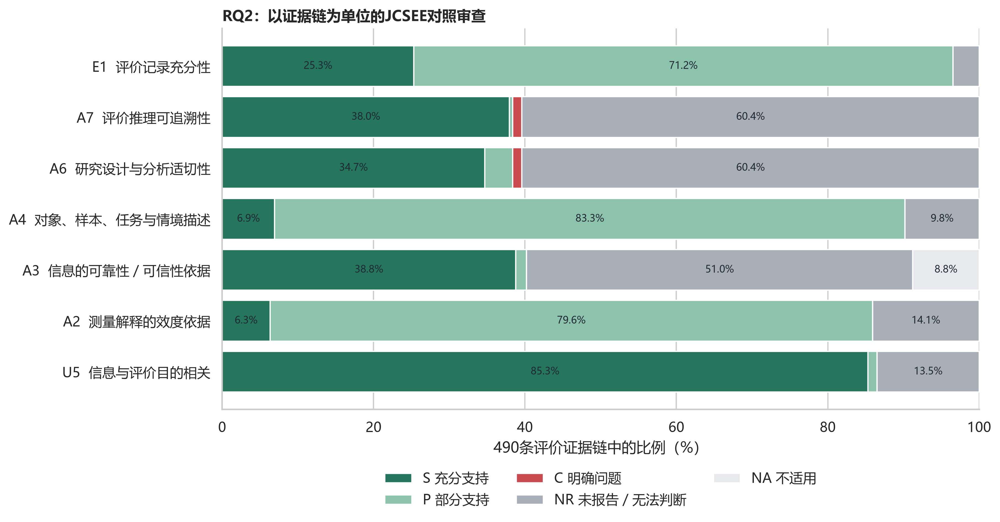

### 3.3 质量层级结果

| 层级 | 证据链数 | 比例 | 用途 |
|---|---:|---:|---|
| Q3 | 436 | 89.0% | 描述统计、敏感性分析和网页回退 |
| Q2 | 42 | 8.6% | 主要关联分析与严格推荐 |
| Q1 | 6 | 1.2% | 高置信实例与严格推荐 |
| EXCLUDE | 6 | 1.2% | 不进入建模 |

Q1仅6条，Q2为42条，说明如果只使用严格规范案例，指标模型无法覆盖足够类别。本文因此把主要规范集作为最严格的验证结果，把扩展规范集作为推荐系统的开发证据，并在界面中清楚标注证据层级和支持论文数。

## 4. RQ3：情境标签如何影响维度、指标和工具选择

### 4.1 建模设计

输入按七组组织：G1评价目的、G2效果主张形式、G3评价对象、G4设计领域与阶段、G5评价主体与目标用户、G6数据源／评价环境／可行约束、G7 AI功能／角色／设计任务。输出采用三级顺序：评价维度→主观指标→测量工具类别及具体工具。预测指标时把已确定维度作为条件；预测工具时把已确定维度和指标作为条件。人工编码的目标变量不会作为同级输入。

模型比较包括频率基线、L2多项逻辑回归、随机森林和直方图梯度提升。所有交叉验证按论文分组，避免同一论文共享参与者、任务、系统和工具的近似证据链同时进入训练和测试。实证对照中，随机按链／实例切分使维度模型Macro-F1由.190升至.343，使工具模型由.234升至.593，显示明显的数据泄漏风险。主指标为Macro-F1，并同时保留加权F1、平衡准确率、准确率、对数损失和Top-2准确率。

### 4.2 模型结果

| 分析集 | 推荐目标 | n | 论文数 | 类别数 | 最优模型 | Macro-F1 | 频率基线 | Top-2准确率 |
|---|---|---:|---:|---:|---|---:|---:|---:|
| 主要规范集 | 评价维度 | 46 | 20 | 4 | L2多项逻辑回归 | 0.148 | 0.130 | 0.406 |
| 主要规范集 | 测量工具类别 | 53 | 21 | 4 | 直方图梯度提升 | 0.222 | 0.136 | 0.496 |
| 扩展规范集 | 评价维度 | 155 | 38 | 5 | 直方图梯度提升 | 0.190 | 0.105 | 0.560 |
| 扩展规范集 | 主观指标 | 95 | 27 | 10 | 随机森林 | 0.548 | 0.013 | 0.786 |
| 扩展规范集 | 测量工具类别 | 182 | 38 | 5 | L2多项逻辑回归 | 0.234 | 0.094 | 0.598 |

主要规范集有48条链，其中47条有可映射指标并分散于22类；类别必须同时达到至少5条链和至少3篇论文，只有A1新颖性达到6条链、5篇论文。因此筛选后是6条观测、1个类别，无法建立多分类模型。扩展规范集的指标模型表现最好：随机森林Macro-F1=.548，Top-2准确率=.786。维度和工具模型虽优于频率基线，但Macro-F1分别只有.190和.234，说明现有语料更适合做带证据强度的候选排序，不适合自动给出唯一答案。

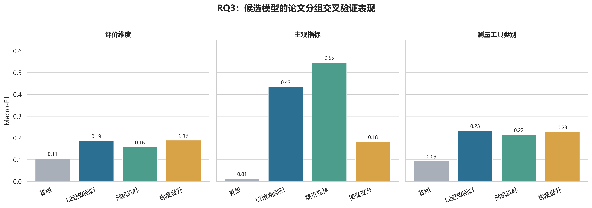

### 4.3 标签组权重

权重由扩展规范集中逐组消融得到：去掉一个标签组后Macro-F1下降越多，该组对当前推荐目标的增量贡献越大；只把正下降归一化为100%。

| 推荐目标 | 标签组及归一化权重 |
|---|---|
| 评价维度 | 可信证据可行条件 46.1%；设计情境 32.0%；评价对象 22.0% |
| 主观指标 | 评价目的 29.5%；相关人的价值 22.3%；AI活动特征 16.8%；效果主张形式 14.3%；设计情境 11.1%；评价对象 6.0% |
| 测量工具类别 | 效果主张形式 29.5%；评价对象 28.0%；AI活动特征 22.9%；评价目的 10.9%；设计情境 8.2%；可信证据可行条件 0.5% |

这给网站的标签交互一个清晰顺序：推荐维度时优先询问数据源与可行条件、设计情境、评价对象；推荐指标时优先询问评价目的、评价主体与用户、AI活动特征和主张形式；推荐工具时优先使用效果主张形式、评价对象、AI活动特征和评价目的。权重不是稳定的理论常数；只有维度模型中G6和G4、指标模型中G1和G5的消融置信区间明确高于0，其余标签应视作探索性排序依据。

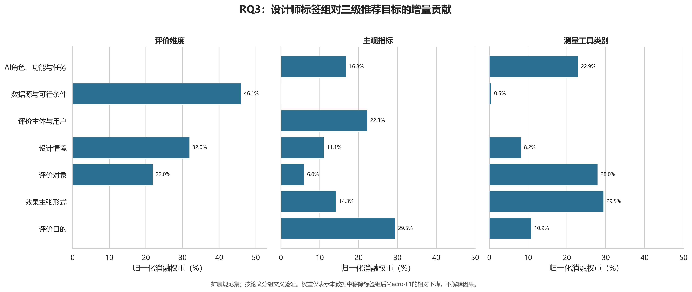

### 4.4 可解释的关联证据

Fisher精确检验、条件概率、lift和有向Cramér’s V用于展示具体标签与输出类别的共同出现关系，并对同批比较做BH校正。主要规范集中，设计学生／新手作为目标用户与M1标准化具名量表明显共同出现（8/9，基线11/48，lift=3.88，q=.001）；第三方人工评价与M2自编结构化评分共同出现（12/22，基线14/48，lift=1.87，q=.021）。扩展规范集中，访谈／开放回答数据源与M3为结构上相符的强关联；设计成果对象更常连接M2，设计过程／工作流对象更常连接M3。前两类结果适合作为推荐解释，后者中包含由定义带来的近确定性关系，应避免把它们误解为独立发现。

## 5. 推荐网页的最终逻辑

1. 设计师先描述拟评价的效果主张，再选择评价目的、评价对象、设计领域、设计阶段、评价主体、目标用户、可用数据源、评价环境与约束，以及AI功能、角色和任务。
2. 系统先给出评价维度候选，显示条件概率、相对基线、支持链数、支持论文数和证据层级。设计师确认或调整维度。
3. 系统在已确认维度下推荐主观指标，仍显示证据支持与不确定性；不把低支持指标隐藏成确定答案。
4. 系统在已确认维度和指标下推荐M1–M5工具类别，再列出可追溯的具名量表或通用工具方案。具体工具至少需要两个独立论文支持才进入默认推荐；单论文工具只在“探索性证据”中显示。
5. 默认先检索主要规范集；样本不足时回退到扩展规范集并明确标注。没有足够证据时返回“证据不足”，同时提示需要补充的报告要素。
6. 网页不能宣称替代研究者判断。它提供的是基于现有文献的可解释候选排序和证据追踪。

## 6. 结论

本研究最重要的发现不是某个设计领域固定对应某种感知维度，而是**评价证据的选择由不同层级的情境标签共同约束，并且约束重点会随推荐目标改变**。设计领域和阶段对维度的总体关联较弱，不能独立承担推荐入口；数据源、评价对象、目的、相关人和AI活动特征提供了更有用的组合信息。现有论文最大的规范性短板是可靠性依据、研究设计／分析说明和从结果到结论的可追溯性。推荐系统因此应同时输出候选、证据量、规范性层级和不确定性。

## 7. 研究限制与下一步

- 12篇论文完成逐页人工复核，113篇依赖全文规则筛查、语义清点和原句回定位。正式投稿前应由第二编码者独立复核，并报告一致性。
- 2026年的文献数量较多，年度趋势可能同时反映检索窗口和语料构成。
- 多条证据链来自同一论文。建模已按论文分组，但描述统计和卡方表仍是证据链展开结果，应同时报告论文数。
- 主要规范集只有48条链，主观指标模型无法建立；扩展规范集结果只用于敏感性和网页回退。
- 工具实例中仍有16个UNMAPPED。它们保留为缺失，避免将含糊文本强行放入M1–M5。
- 当前模型验证的是对现有文献编码的预测，尚未验证网站建议能否提高新研究的测量效度。下一步需要前瞻性用户研究和外部语料验证。