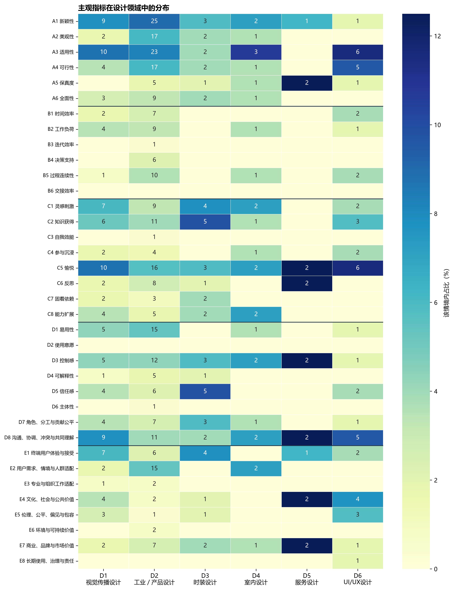
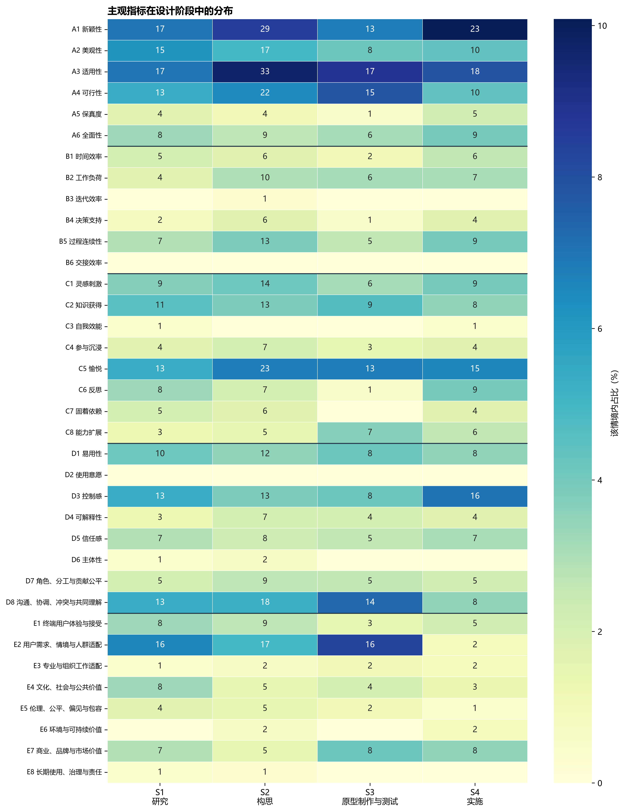
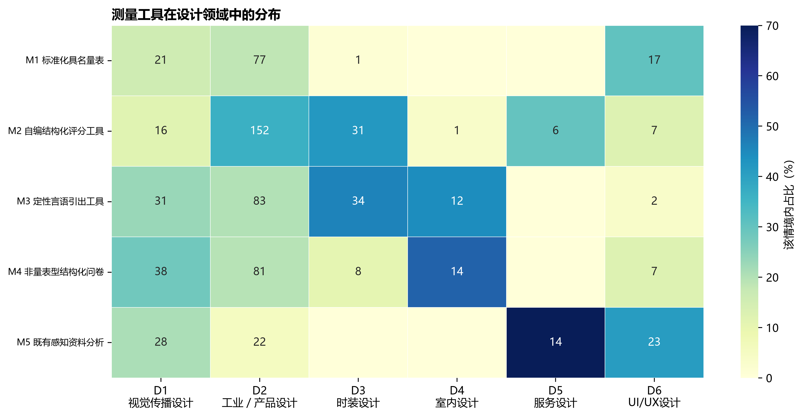
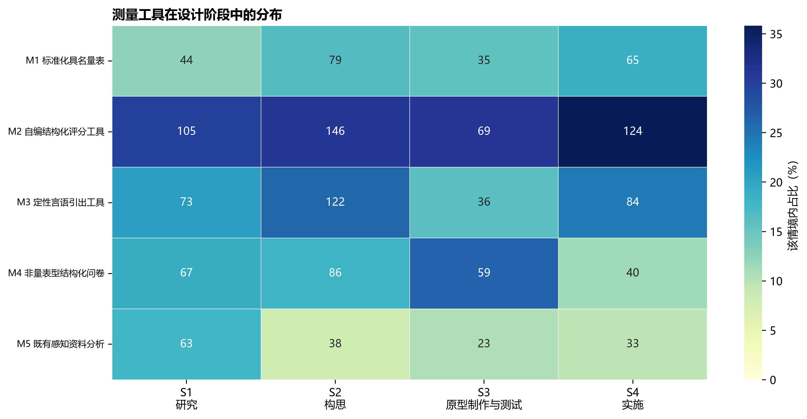
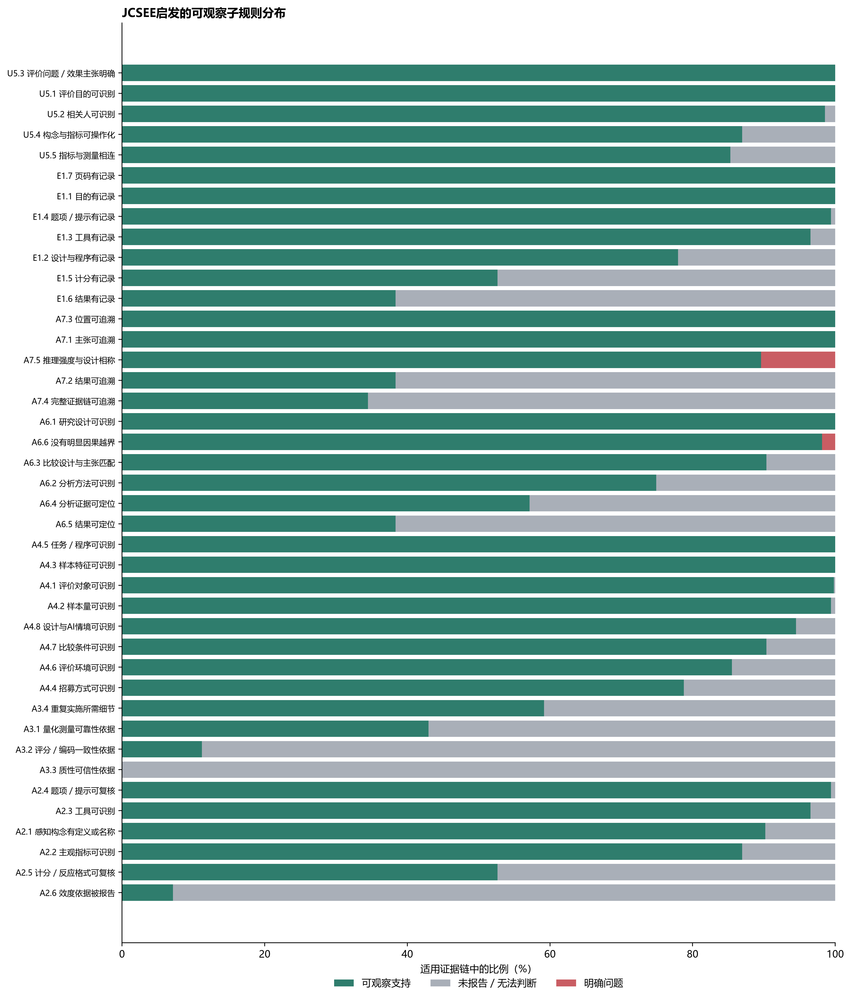

# AI-assisted Design workflow 感知效应研究：问题答复与补充分析

## 结论口径

本文件修正并补充主报告中的七个问题。JCSEE部分应表述为**“以JCSEE为依据的、基于公开论文文本的评价证据链报告充分性与方法适切性审查”**，不能表述为对一项完整项目评价是否全面符合JCSEE 30项标准的认证。下面A2.1等编号均为本研究为复核而设置的可观察检查项，并非JCSEE发布的官方子条款。

## 1. 125篇论文、158个案例、490条证据链和600个工具实例如何对应

这是四个嵌套但不同的分析单位：

1. **论文**是文献容器。
2. **评价案例**是论文内一个可独立识别的样本、实验、研究或评价协议。同一论文可包含多个研究或多组评价。
3. **评价证据链**是针对一个感知效应形成的“效果主张／评价问题→构念→指标→测量”。同一案例可评价多个感知效应，因此拆成多条链。
4. **测量工具实例**是某条链实际使用的一种具体工具。同一条链可同时使用量表、访谈或结构化问卷，因此工具实例数可以大于链数。

| 转换 | 上级总数 | 有下级 | 无下级 | 下级总数 | 每个上级包含的下级数量分布 |
|---|---|---|---|---|---|
| 论文→评价案例 | 125 | 94 | 31 | 158 | {"1": 54, "2": 27, "3": 12, "14": 1} |
| 评价案例→评价证据链 | 158 | 158 | 0 | 490 | {"1": 77, "2": 19, "3": 14, "4": 12, "5": 6, "6": 6, "7": 4, "8": 7, "9": 5, "10": 3, "12": 5} |
| 评价证据链→测量工具实例 | 490 | 490 | 0 | 600 | {"1": 380, "2": 110} |

具体算式为：54×1+27×2+12×3+1×14=158个案例；77×1+19×2+14×3+12×4+6×5+6×6+4×7+7×8+5×9+3×10+5×12=490条链；380×1+110×2=600个工具实例。125篇中94篇产生了纳入条件内的人类主观评价案例，31篇没有产生这类案例。

## 2. JCSEE如何被操作化

JCSEE第三版包含30项标准。官方说明明确指出，标准陈述本身不能传达每项标准的完整含义，实际应用还需要完整指南和具体情境。因此，本研究没有声称“完全按JCSEE判定合规”，而是：先选取可由公开论文文本观察、且与感知评价证据链直接相关的7项标准；再把它们转成可重复编码的文本规则；最后用S、P、NR、C和NA记录支持程度。

### 2.1 纳入的7项标准

| 标准 | 官方标准名称 | 本研究观察内容 | 纳入理由 |
|---|---|---|---|
| U5 | Relevant Information／相关信息 | 效果主张、构念、指标和工具是否形成与评价目的相关的链 | 直接对应证据链的相关性和可操作性 |
| A2 | Valid Information／有效信息 | 构念、指标、工具、题项、计分和效度依据 | 判断测量能否支持预期解释 |
| A3 | Reliable Information／可靠信息 | 量化信度、评分／编码一致性、质性可信性和重复实施细节 | 判断信息是否足够稳定、一致 |
| A4 | Explicit Program and Context Descriptions／明确对象与情境 | 对象、样本、招募、任务、环境、比较条件及AI设计情境 | 判断证据适用边界 |
| A6 | Sound Designs and Analyses／健全设计与分析 | 设计、分析、比较条件、结果及因果越界 | 判断设计和分析是否支撑主张 |
| A7 | Explicit Evaluation Reasoning／明确评价推理 | 主张、结果、位置、完整证据链和推理强度 | 判断从信息到结论是否可追溯 |
| E1 | Evaluation Documentation／评价记录 | 目的、设计、程序、工具、题项、计分、结果和位置 | 判断读者能否复核评价过程 |

### 2.2 没有进入链级质量层级的23项标准

| 代码 | 标准 | 未进入链级层级的原因 |
|---|---|---|
| U1 | Evaluator Credibility／评价者可信度 | 评价者资格和情境信誉通常无法由一条证据链判断 |
| U2 | Attention to Stakeholders／关注利益相关者 | 论文可识别部分用户，但无法判断是否关注了完整利益相关者范围 |
| U3 | Negotiated Purposes／协商目的 | 目的如何持续协商通常不报告 |
| U4 | Explicit Values／明确价值 | 目标用户不等于支撑判断的个人与文化价值已被明确 |
| U6 | Meaningful Processes and Products／有意义的过程与成果 | 参与者理解和行为改变多在评价实施之外 |
| U7 | Timely and Appropriate Communicating and Reporting／及时适当沟通 | 受众、时机和传播过程无法从测量链判断 |
| U8 | Concern for Consequences and Influence／关注后果与影响 | 评价被使用后的后果通常不在论文中 |
| F1–F4 | 项目管理、程序实用性、情境可行性、资源使用 | 需要预算、政治情境、实施管理和资源记录；论文正文通常不足 |
| P1–P7 | 回应与包容、协议、人权、公平、披露、利益冲突、财务责任 | 多为组织与伦理治理层面；伦理或利益冲突声明只能覆盖局部，不能等同整项标准 |
| A1 | Justified Conclusions and Decisions／有依据的结论与决定 | 与A7和A4部分重叠，且需要结论产生后果的文化与情境证据；为避免重复计权而未单列 |
| A5 | Information Management／信息管理 | 需要收集、复核、验证和存储流程，公开论文通常不完整 |
| A8 | Communication and Reporting／沟通与报告 | 属于整篇报告的范围、偏差和误导风险，不适合链级计分；局部记录由A7和E1覆盖 |
| E2 | Internal Metaevaluation／内部元评价 | 需要研究团队实际进行元评价的证据 |
| E3 | External Metaevaluation／外部元评价 | 需要独立外部元评价的证据 |

这些标准没有被判定为“不重要”。它们需要项目管理记录、利益相关者协商材料、伦理治理文件、资源信息或元评价材料，不能把论文“没有写”直接编码成研究“没有做”。其中伦理审批、利益冲突和局限披露可以另建论文级报告项，但不能替代P3、P5或P6的完整判断。

## 3. 评价维度百分比为何没有加到100%

已映射维度的分母是432条证据链，五类计数为136、41、101、91、63，合计正好432。此前表格分别四舍五入到1位小数，得到31.5%、9.5%、23.4%、21.1%和14.6%，显示合计为100.1%。这是独立四舍五入产生的0.1个百分点误差，不是重复编码。

| 维度 | 证据链 | 精确比例 |
|---|---|---|
| A 设计成果质量 | 136 | 31.481% |
| B 设计过程质量 | 41 | 9.491% |
| C 设计者认知、情感与能力 | 101 | 23.380% |
| D 人机交互体验 | 91 | 21.065% |
| E 社会情境价值 | 63 | 14.583% |

修订报告改用三位小数并注明分母，五项显示值合计100.000%。

## 4. 主观指标和测量工具在设计领域与设计阶段中的分布

### 4.1 呈现方法

指标有36类，适合使用两张分面热图：行是按A–E分组的指标，列分别为6个设计领域和4个设计阶段；颜色表示该领域／阶段内部的比例，格内数字表示原始计数。工具只有5类，使用两张5行热图即可放入正文。指标图适合作为正文概览加补充材料详表，避免用36组并列柱形图造成视觉拥挤。

一条链可对应多个领域或阶段，一条链也可有多个工具，所以这里统计的是“情境—链”或“情境—工具实例”展开后的分配次数。检验只作为探索性描述；尤其指标×领域有84.8%的期望频数小于5，不能根据普通卡方p值作强推断。

| 关系 | 展开分配数 | χ²(df) | p | Cramér’s V | 期望频数<5比例 |
|---|---|---|---|---|---|
| 主观指标×设计领域 | 540 | 175.86 (165) | 0.267 | 0.255 | 84.8% |
| 测量工具×设计领域 | 726 | 260.66 (20) | 8.05e-44 | 0.300 | 20.0% |
| 主观指标×设计阶段 | 1003 | 73.58 (99) | 0.974 | 0.156 | 41.2% |
| 测量工具×设计阶段 | 1391 | 50.31 (12) | 1.23e-06 | 0.110 | 0.0% |

结论是：指标构成在领域和阶段之间都没有稳定的总体差异；工具类别与设计领域的关联较明显（V=.300），与设计阶段的关联较弱（V=.110）。这些是语料中的选择模式，不表示领域或阶段对工具有因果作用。

### 4.2 各设计领域的高频主观指标

| 设计领域 | 前5类指标：n（领域内比例） |
|---|---|
| D1 视觉传播设计 | A3 适用性 10 (8.7%)；C5 愉悦 10 (8.7%)；A1 新颖性 9 (7.8%)；D8 沟通、协调、冲突与共同理解 9 (7.8%)；C1 灵感刺激 7 (6.1%) |
| D2 工业／产品设计 | A1 新颖性 25 (9.0%)；A3 适用性 23 (8.3%)；A2 美观性 17 (6.1%)；A4 可行性 17 (6.1%)；C5 愉悦 16 (5.8%) |
| D3 时装设计 | C2 知识获得 5 (9.8%)；D5 信任感 5 (9.8%)；C1 灵感刺激 4 (7.8%)；E1 终端用户体验与接受 4 (7.8%)；A1 新颖性 3 (5.9%) |
| D4 室内设计 | A3 适用性 3 (10.7%)；A1 新颖性 2 (7.1%)；C1 灵感刺激 2 (7.1%)；C5 愉悦 2 (7.1%)；C8 能力扩展 2 (7.1%) |
| D5 服务设计 | A5 保真度 2 (12.5%)；C5 愉悦 2 (12.5%)；C6 反思 2 (12.5%)；D3 控制感 2 (12.5%)；D8 沟通、协调、冲突与共同理解 2 (12.5%) |
| D6 UI/UX设计 | A3 适用性 6 (11.5%)；C5 愉悦 6 (11.5%)；A4 可行性 5 (9.6%)；D8 沟通、协调、冲突与共同理解 5 (9.6%)；E4 文化、社会与公共价值 4 (7.7%) |

### 4.3 各设计阶段的高频主观指标

| 设计阶段 | 前5类指标：n（阶段内比例） |
|---|---|
| S1 研究 | A1 新颖性 17 (7.0%)；A3 适用性 17 (7.0%)；E2 用户需求、情境与人群适配 16 (6.6%)；A2 美观性 15 (6.2%)；A4 可行性 13 (5.3%) |
| S2 构思 | A3 适用性 33 (9.7%)；A1 新颖性 29 (8.5%)；C5 愉悦 23 (6.8%)；A4 可行性 22 (6.5%)；D8 沟通、协调、冲突与共同理解 18 (5.3%) |
| S3 原型制作与测试 | A3 适用性 17 (8.9%)；E2 用户需求、情境与人群适配 16 (8.3%)；A4 可行性 15 (7.8%)；D8 沟通、协调、冲突与共同理解 14 (7.3%)；A1 新颖性 13 (6.8%) |
| S4 实施 | A1 新颖性 23 (10.1%)；A3 适用性 18 (7.9%)；D3 控制感 16 (7.0%)；C5 愉悦 15 (6.6%)；A2 美观性 10 (4.4%) |

### 4.4 测量工具分布

| 设计领域 | 工具：n（领域内比例） |
|---|---|
| D1 视觉传播设计 | M4 非量表型结构化问卷 38 (28.4%)；M3 定性言语引出工具 31 (23.1%)；M5 既有感知资料分析 28 (20.9%)；M1 标准化具名量表 21 (15.7%)；M2 自编结构化评分工具 16 (11.9%) |
| D2 工业／产品设计 | M2 自编结构化评分工具 152 (36.6%)；M3 定性言语引出工具 83 (20.0%)；M4 非量表型结构化问卷 81 (19.5%)；M1 标准化具名量表 77 (18.6%)；M5 既有感知资料分析 22 (5.3%) |
| D3 时装设计 | M3 定性言语引出工具 34 (45.9%)；M2 自编结构化评分工具 31 (41.9%)；M4 非量表型结构化问卷 8 (10.8%)；M1 标准化具名量表 1 (1.4%)；M5 既有感知资料分析 0 (0.0%) |
| D4 室内设计 | M4 非量表型结构化问卷 14 (51.9%)；M3 定性言语引出工具 12 (44.4%)；M2 自编结构化评分工具 1 (3.7%)；M1 标准化具名量表 0 (0.0%)；M5 既有感知资料分析 0 (0.0%) |
| D5 服务设计 | M5 既有感知资料分析 14 (70.0%)；M2 自编结构化评分工具 6 (30.0%)；M1 标准化具名量表 0 (0.0%)；M3 定性言语引出工具 0 (0.0%)；M4 非量表型结构化问卷 0 (0.0%) |
| D6 UI/UX设计 | M5 既有感知资料分析 23 (41.1%)；M1 标准化具名量表 17 (30.4%)；M2 自编结构化评分工具 7 (12.5%)；M4 非量表型结构化问卷 7 (12.5%)；M3 定性言语引出工具 2 (3.6%) |

| 设计阶段 | 工具：n（阶段内比例） |
|---|---|
| S1 研究 | M2 自编结构化评分工具 105 (29.8%)；M3 定性言语引出工具 73 (20.7%)；M4 非量表型结构化问卷 67 (19.0%)；M5 既有感知资料分析 63 (17.9%)；M1 标准化具名量表 44 (12.5%) |
| S2 构思 | M2 自编结构化评分工具 146 (31.0%)；M3 定性言语引出工具 122 (25.9%)；M4 非量表型结构化问卷 86 (18.3%)；M1 标准化具名量表 79 (16.8%)；M5 既有感知资料分析 38 (8.1%) |
| S3 原型制作与测试 | M2 自编结构化评分工具 69 (31.1%)；M4 非量表型结构化问卷 59 (26.6%)；M3 定性言语引出工具 36 (16.2%)；M1 标准化具名量表 35 (15.8%)；M5 既有感知资料分析 23 (10.4%) |
| S4 实施 | M2 自编结构化评分工具 124 (35.8%)；M3 定性言语引出工具 84 (24.3%)；M1 标准化具名量表 65 (18.8%)；M4 非量表型结构化问卷 40 (11.6%)；M5 既有感知资料分析 33 (9.5%) |

## 5. JCSEE标准的选择依据、逐条可观察规则及分布

选择规则同时满足三点：第一，标准与评价信息、测量、情境、设计分析、推理或记录直接相关；第二，能从公开论文中的可定位文本判断；第三，能够落到单条评价证据链或其所属评价案例。S表示论文文本提供可观察支持，NR表示未报告或无法判断，C表示存在明确冲突，NA表示该规则对该链不适用。NR不能解释为研究实际没有实施该程序。

| 标准 | 规则 | 名称 | 可观察判定 | 依据 | 支持S／适用数 | NR | C | NA |
|---|---|---|---|---|---|---|---|---|
| A2 | A2.1 | 感知构念有定义或名称 | construct_raw可定位 | 有效解释需要明确被解释的构念 | 442/490 (90.2%) | 48 | 0 | 0 |
| A2 | A2.2 | 主观指标可识别 | indicator_raw存在且indicator_code有效 | 测量解释需明确指标 | 426/490 (86.9%) | 64 | 0 | 0 |
| A2 | A2.3 | 工具可识别 | instrument_raw存在且工具类别可判定 | 有效信息需说明取得方式 | 473/490 (96.5%) | 17 | 0 | 0 |
| A2 | A2.4 | 题项／提示可复核 | item_quote存在 | 题项或提示支持内容效度判断 | 487/490 (99.4%) | 3 | 0 | 0 |
| A2 | A2.5 | 计分／反应格式可复核 | response_scoring存在 | 解释分数需要计分和反应格式 | 258/490 (52.7%) | 232 | 0 | 0 |
| A2 | A2.6 | 效度依据被报告 | validity_evidence含效度、预测试、专家审查或验证信息 | A2直接要求信息支持有效解释 | 35/490 (7.1%) | 455 | 0 | 0 |
| A3 | A3.1 | 量化测量可靠性依据 | 量化工具报告alpha、ICC、重测或其他可靠性证据 | A3要求程序产生足够一致的信息 | 119/277 (43.0%) | 158 | 0 | 213 |
| A3 | A3.2 | 评分／编码一致性依据 | 第三方评分或质性编码报告评分者／编码者一致性 | 多人判断时需检验一致性 | 41/366 (11.2%) | 325 | 0 | 124 |
| A3 | A3.3 | 质性可信性依据 | 定性工具报告饱和、三角互证、成员核查或双人编码 | 质性资料以可信性程序对应A3 | 0/130 (0.0%) | 130 | 0 | 360 |
| A3 | A3.4 | 重复实施所需细节 | 有题项／提示且有计分说明，或使用可识别具名量表 | 程序细节是稳定复现的最低报告条件 | 290/490 (59.2%) | 200 | 0 | 0 |
| A4 | A4.1 | 评价对象可识别 | objects至少有一个有效代码 | A4要求明确描述被评价对象 | 489/490 (99.8%) | 1 | 0 | 0 |
| A4 | A4.2 | 样本量可识别 | sample_n有有效值 | 判断证据适用范围需要样本规模 | 487/490 (99.4%) | 3 | 0 | 0 |
| A4 | A4.3 | 样本特征可识别 | sample_description有有效值 | A4要求对象与情境适当细节 | 490/490 (100.0%) | 0 | 0 | 0 |
| A4 | A4.4 | 招募方式可识别 | recruitment有有效值 | 招募影响样本边界与偏差判断 | 386/490 (78.8%) | 104 | 0 | 0 |
| A4 | A4.5 | 任务／程序可识别 | task或procedure至少一项存在 | 评价情境需说明参与者做了什么 | 490/490 (100.0%) | 0 | 0 | 0 |
| A4 | A4.6 | 评价环境可识别 | setting有有效代码 | 实验室、线上、现场等影响解释 | 419/490 (85.5%) | 71 | 0 | 0 |
| A4 | A4.7 | 比较条件可识别 | 比较／因果主张时comparator存在；其他主张NA | 条件比较必须描述比较基础 | 103/114 (90.4%) | 11 | 0 | 376 |
| A4 | A4.8 | 设计与AI情境可识别 | 设计领域、阶段及AI功能／角色均可识别 | 本研究问题要求明确AI辅助设计情境 | 463/490 (94.5%) | 27 | 0 | 0 |
| A6 | A6.1 | 研究设计可识别 | design至少有一个有效代码 | 适切性判断先要识别设计 | 490/490 (100.0%) | 0 | 0 | 0 |
| A6 | A6.2 | 分析方法可识别 | analysis字段报告分析程序 | A6要求技术上适切的分析 | 367/490 (74.9%) | 123 | 0 | 0 |
| A6 | A6.3 | 比较设计与主张匹配 | C2/C3主张有比较条件；其他主张NA | 比较或因果推断需比较基础 | 103/114 (90.4%) | 11 | 0 | 376 |
| A6 | A6.4 | 分析证据可定位 | 报告统计检验、回归、混合模型、质性分析或置信区间等 | 不能仅凭结论判断分析充分 | 280/490 (57.1%) | 210 | 0 | 0 |
| A6 | A6.5 | 结果可定位 | result_quote存在 | 设计和分析应产生可复核结果 | 188/490 (38.4%) | 302 | 0 | 0 |
| A6 | A6.6 | 没有明显因果越界 | 明确因果主张同时具有比较条件和分析证据；非因果主张通过 | 防止设计能力低于结论强度 | 481/490 (98.2%) | 0 | 9 | 0 |
| A7 | A7.1 | 主张可追溯 | claim_quote或claim_summary存在 | 推理起点可见 | 490/490 (100.0%) | 0 | 0 | 0 |
| A7 | A7.2 | 结果可追溯 | result_quote存在 | 推理所依据的信息可见 | 188/490 (38.4%) | 302 | 0 | 0 |
| A7 | A7.3 | 位置可追溯 | pages存在 | 允许回到全文复核 | 490/490 (100.0%) | 0 | 0 | 0 |
| A7 | A7.4 | 完整证据链可追溯 | 主张、构念、指标、工具、结果均存在 | 从问题到结论的中间环节完整 | 169/490 (34.5%) | 321 | 0 | 0 |
| A7 | A7.5 | 推理强度与设计相称 | C2/C3具有比较／分析支持，其他类型通过 | A7要求显式记录从分析到判断的推理 | 439/490 (89.6%) | 0 | 51 | 0 |
| E1 | E1.1 | 目的有记录 | purposes存在 | E1要求记录协商目的 | 490/490 (100.0%) | 0 | 0 | 0 |
| E1 | E1.2 | 设计与程序有记录 | design与procedure存在 | E1要求记录实施设计和程序 | 382/490 (78.0%) | 108 | 0 | 0 |
| E1 | E1.3 | 工具有记录 | instrument_raw存在且工具类别可判定 | E1要求记录数据取得程序 | 473/490 (96.5%) | 17 | 0 | 0 |
| E1 | E1.4 | 题项／提示有记录 | item_quote存在 | 支持复核具体测量内容 | 487/490 (99.4%) | 3 | 0 | 0 |
| E1 | E1.5 | 计分有记录 | response_scoring存在 | 支持复核数据如何形成 | 258/490 (52.7%) | 232 | 0 | 0 |
| E1 | E1.6 | 结果有记录 | result_quote存在 | E1要求记录结果 | 188/490 (38.4%) | 302 | 0 | 0 |
| E1 | E1.7 | 页码有记录 | pages存在 | 支持文献内回溯 | 490/490 (100.0%) | 0 | 0 | 0 |
| U5 | U5.1 | 评价目的可识别 | purposes至少有一个有效代码 | U5要求信息服务于已识别需求；目的必须先可识别 | 490/490 (100.0%) | 0 | 0 | 0 |
| U5 | U5.2 | 相关人可识别 | 评价主体或目标用户至少一项可识别 | 用可报告的相关人代理stakeholder information needs | 483/490 (98.6%) | 7 | 0 | 0 |
| U5 | U5.3 | 评价问题／效果主张明确 | 有原文主张或可追溯主张摘要 | 评价证据必须回答明确问题 | 490/490 (100.0%) | 0 | 0 | 0 |
| U5 | U5.4 | 构念与指标可操作化 | 构念存在且指标映射到既定代码 | 相关信息需转化为可测构念与指标 | 426/490 (86.9%) | 64 | 0 | 0 |
| U5 | U5.5 | 指标与测量相连 | 证据链至少有一个可判定M1–M5工具实例 | 信息必须有取得证据的程序 | 418/490 (85.3%) | 72 | 0 | 0 |

最突出的报告缺口是：质性可信性程序0/130；效度依据35/490（7.1%）；评分／编码一致性41/366（11.2%）；完整证据链可追溯169/490（34.5%）；结果可定位188/490（38.4%）；量化可靠性依据119/277（43.0%）；计分／反应格式258/490（52.7%）。这些子规则用于诊断缺口，不重新计算原Q1/Q2/Q3层级，避免事后改变已定义的纳入阈值。

### 5.1 扩展规范集允许A3未报告的含义

扩展规范集要求U5、A2、A4、A6、A7和E1均至少达到S或P，所有标准均不得出现C；唯一放宽的是A3允许NR。它表示：论文提供了足以识别评价目的、证据链、情境、设计／分析和推理的文本，但没有报告可靠性或质性可信性依据，因此可靠性是**未知**，不是“已证明可靠”，也不是“已证明不可靠”。该集合只用于敏感性分析和网站证据不足时的回退，不应用于高置信规范结论。

## 6. 为什么按论文分组训练和测试

同一论文中的多条链通常共享参与者、任务、AI系统、实验条件、工具措辞和作者报告习惯。如果随机按链切分，同一论文的近似记录会同时进入训练集和测试集，模型可以识别论文特征而不是真正学习跨研究规律，形成数据泄漏。

| 目标 | 模型 | 验证方式 | n | 论文 | 类别 | Macro-F1 | 准确率 | Top-2准确率 | 相对分组验证变化 |
|---|---|---|---|---|---|---|---|---|---|
| 评价维度 | 直方图梯度提升 | 按论文分组 | 155 | 38 | 5 | 0.190 | 0.322 | 0.560 | +0.0% |
| 评价维度 | 直方图梯度提升 | 随机按证据链／实例 | 155 | 38 | 5 | 0.343 | 0.406 | 0.677 | +80.6% |
| 主观指标 | 随机森林 | 按论文分组 | 95 | 27 | 10 | 0.548 | 0.504 | 0.786 | +0.0% |
| 主观指标 | 随机森林 | 随机按证据链／实例 | 95 | 27 | 10 | 0.537 | 0.568 | 0.758 | -2.0% |
| 测量工具类别 | L2多项逻辑回归 | 按论文分组 | 182 | 38 | 5 | 0.234 | 0.257 | 0.598 | +0.0% |
| 测量工具类别 | L2多项逻辑回归 | 随机按证据链／实例 | 182 | 38 | 5 | 0.593 | 0.642 | 0.934 | +153.9% |

随机切分使维度模型Macro-F1虚高80.6%，使工具模型虚高153.9%。指标模型这一次随机切分没有提高Macro-F1，但不能消除同论文泄漏的结构性风险。因此最终报告按论文分组，衡量模型能否迁移到未见过的新论文。

## 7. 48条主要规范证据链为何只剩6条指标观测

48是“证据链数量”，不是“指标类别数量”。其中47条有可映射指标，分散在22个指标类别中；建模前还要求目标类别至少有5条证据链且来自至少3篇不同论文。只有A1新颖性达到6条链、5篇论文，其他21类都没有同时满足两个阈值，所以筛选后只有6条观测、1个类别，无法建立多分类模型。

| 指标 | 证据链 | 论文 | 达到≥5条链且≥3篇论文 |
|---|---|---|---|
| A1 新颖性 | 6 | 5 | 是 |
| C8 能力扩展 | 4 | 3 | 否 |
| E2 用户需求、情境与人群适配 | 4 | 2 | 否 |
| D8 沟通、协调、冲突与共同理解 | 3 | 3 | 否 |
| E4 文化、社会与公共价值 | 3 | 3 | 否 |
| A4 可行性 | 3 | 2 | 否 |
| D1 易用性 | 3 | 2 | 否 |
| D7 角色、分工与贡献公平 | 3 | 2 | 否 |
| A2 美观性 | 2 | 2 | 否 |
| A3 适用性 | 2 | 2 | 否 |
| A6 全面性 | 2 | 2 | 否 |
| C5 愉悦 | 2 | 2 | 否 |
| A5 保真度 | 1 | 1 | 否 |
| B1 时间效率 | 1 | 1 | 否 |
| B5 过程连续性 | 1 | 1 | 否 |
| C1 灵感刺激 | 1 | 1 | 否 |
| C2 知识获得 | 1 | 1 | 否 |
| C4 参与沉浸 | 1 | 1 | 否 |
| C6 反思 | 1 | 1 | 否 |
| E1 终端用户体验与接受 | 1 | 1 | 否 |
| E3 专业与组织工作适配 | 1 | 1 | 否 |
| E7 商业、品牌与市场价值 | 1 | 1 | 否 |

这不是说其余42条规范链没有主观指标，而是它们分散到低频类别；另有1条指标未映射。为了避免用极少数论文训练出貌似精确的推荐，主要规范集不建立指标模型。扩展规范集有95条达到阈值的观测、10个类别，才进行探索性建模。

## 资料依据

- JCSEE Program Evaluation Standards：https://evaluationstandards.org/program/
- WMU Checklist of the Program Evaluation Standards Statements：https://files.wmich.edu/s3fs-public/attachments/u350/2021/program-eval-standards-jc.pdf

