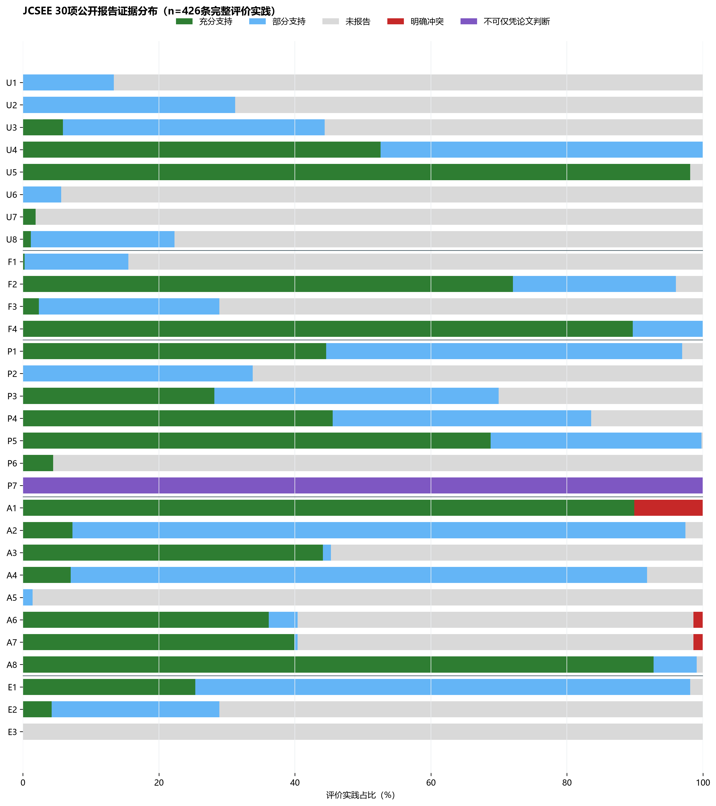
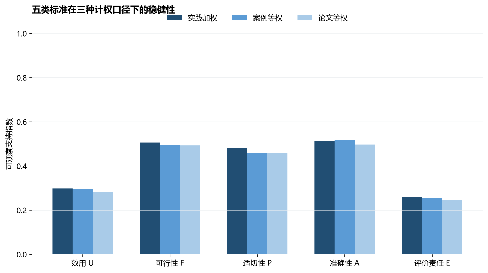

# RQ2：基于JCSEE 30项的全文规范性重审

## 1. 审查口径

- 语料：125篇全文论文。
- 125篇全文中，94篇形成候选评价记录；原数据库评价案例158个。进入本次规范性审查的完整实践来自108个案例、66篇论文。
- 候选评价记录：490条。全文结构复核后，426条同时具有效果主张、构念、固定二级指标和测量工具，构成可审查的完整评价实践；64条不完整候选记录另表排除。
- 审查单位：`practice_id = chain_id`。每条实践由论文级事实、案例级事实和链级事实合并后审查30项标准。
- 状态：S充分支持、P部分支持、NR未报告、C明确冲突、NA不适用、UJ仅凭论文无法判断。NR与UJ均不解释为现实中没有实施。
- 本研究是JCSEE启发的公开报告质量操作化审查，不是JCSEE官方认证。JCSEE标准陈述被转换为可由论文文本编码的观察规则。

## 2. 实施步骤

1. 对含候选评价实践的论文重新定位方法、参与者、伦理、分析、讨论、限制、资助、利益冲突与数据声明页。
2. 提取带物理页码和逐字短引文的论文级证据，并验证引文确实存在于指定页。
3. 按`paper_id`和`eval_id`把论文级、案例级信息连接到每条证据链。
4. 对U5、F2、P4、A1–A7和E1等与具体评价直接相关的标准，结合案例与链字段逐实践复核；其余标准继承论文全文证据。
5. 分别汇总实践加权、案例聚类和论文聚类结果；三种口径用于检查多链论文造成的重复计权。

## 3. 总体结果

|口径|单位数|可判断标准平均支持指数|
|---|---:|---:|
|practice|426|42.1%|
|case|108|41.4%|
|paper|66|40.3%|

可观察支持指数仅用于描述公开报告覆盖度：`(S + 0.5×P)/(S+P+NR+C)`；NA和UJ不进入分母。它不是“合规总分”，也不把各标准视为同等重要。

## 4. 五个标准家族的实践级结果

|家族|平均可观察支持指数|中位数|
|---|---:|---:|
|A|0.514|0.500|
|E|0.261|0.167|
|F|0.506|0.500|
|P|0.483|0.500|
|U|0.298|0.312|

## 5. 30项规则分布（实践加权）

### 效用 U

|标准|S|P|NR|C|NA|UJ|支持指数%|
|---|---:|---:|---:|---:|---:|---:|---:|
|U1 Evaluator Credibility|0|57|369|0|0|0|6.7|
|U2 Attention to Stakeholders|0|133|293|0|0|0|15.6|
|U3 Negotiated Purposes|25|164|237|0|0|0|25.1|
|U4 Explicit Values|224|202|0|0|0|0|76.3|
|U5 Relevant Information|418|0|8|0|0|0|98.1|
|U6 Meaningful Processes and Products|0|24|402|0|0|0|2.8|
|U7 Timely and Appropriate Communicating and Reporting|8|0|418|0|0|0|1.9|
|U8 Concern for Consequences and Influence|5|90|331|0|0|0|11.7|
### 可行性 F

|标准|S|P|NR|C|NA|UJ|支持指数%|
|---|---:|---:|---:|---:|---:|---:|---:|
|F1 Project Management|1|65|360|0|0|0|7.9|
|F2 Practical Procedures|307|102|17|0|0|0|84.0|
|F3 Contextual Viability|10|113|303|0|0|0|15.6|
|F4 Resource Use|382|44|0|0|0|0|94.8|
### 适切性 P

|标准|S|P|NR|C|NA|UJ|支持指数%|
|---|---:|---:|---:|---:|---:|---:|---:|
|P1 Responsive and Inclusive Orientation|190|223|13|0|0|0|70.8|
|P2 Formal Agreements|0|144|282|0|0|0|16.9|
|P3 Human Rights and Respect|120|178|128|0|0|0|49.1|
|P4 Clarity and Fairness|194|162|70|0|0|0|64.6|
|P5 Transparency and Disclosure|293|132|1|0|0|0|84.3|
|P6 Conflicts of Interests|19|0|407|0|0|0|4.5|
|P7 Fiscal Responsibility|0|0|0|0|0|426|—|
### 准确性 A

|标准|S|P|NR|C|NA|UJ|支持指数%|
|---|---:|---:|---:|---:|---:|---:|---:|
|A1 Justified Conclusions and Decisions|383|0|0|43|0|0|89.9|
|A2 Valid Information|31|384|11|0|0|0|52.3|
|A3 Reliable Information|188|5|233|0|0|0|44.7|
|A4 Explicit Program and Context Descriptions|30|361|35|0|0|0|49.4|
|A5 Information Management|0|6|420|0|0|0|0.7|
|A6 Sound Designs and Analyses|154|18|248|6|0|0|38.3|
|A7 Explicit Evaluation Reasoning|170|2|248|6|0|0|40.1|
|A8 Communication and Reporting|395|27|4|0|0|0|95.9|
### 评价责任 E

|标准|S|P|NR|C|NA|UJ|支持指数%|
|---|---:|---:|---:|---:|---:|---:|---:|
|E1 Evaluation Documentation|108|310|8|0|0|0|61.7|
|E2 Internal Metaevaluation|18|105|303|0|0|0|16.5|
|E3 External Metaevaluation|0|0|426|0|0|0|0.0|

## 6. 结果解释

- 三种计权口径的可判断标准平均支持指数为40.3%–42.1%，最大差异1.8个百分点，说明总体结论并非由少数多链论文单独造成。P7因全部为UJ，不进入该平均值。
- 公开报告支持较充分的项目是U5相关信息、A8沟通与报告、F4资源使用、A1结论依据、P5透明披露和F2实际程序。
- 报告缺口最集中于E3外部元评价、A5信息管理、U7持续沟通、U6有意义过程、P6利益冲突、U1评价者可信度与F1项目管理。
- P7财政责任在426条实践中全部记为UJ，因为学术论文通常不提供预算、支出控制和财政审计材料，不能将其解释为“不符合”。
- 共49条实践（12个案例、11篇论文）至少出现一项明确冲突。冲突集中于A1（43次）以及A6、A7（各6次），反映结论强度、研究设计与推理链之间的可定位不一致。
- 实践级可观察支持指数的中位数为0.431，四分位区间为0.362–0.466。该指数只描述公开报告覆盖度，不用于给论文贴“合格／不合格”标签。

## 7. 解释边界

- S/P表示论文公开文本对该标准提供了充分／部分可观察支持。
- NR表示全文未报告或本次无法定位，不等于作者现实中未实施。
- C只在文本出现明确、可定位的方法或推理冲突时使用。
- UJ主要用于财政责任等通常需要论文外管理材料的标准。
- 同一论文的共享事实会连接到多条实践，因此主结果之外必须同时查看案例聚类与论文聚类结果。
- 64条不完整候选记录没有被当成完整实践计算规范性；排除原因逐条保存在登记表中。RQ3尚未启动。

## 8. 依据

- JCSEE, *Program Evaluation Standards*（第三版，2010）。官方页面列出30项标准，并明确提示仅凭标准陈述不能涵盖每项标准的完整含义；完整应用需结合指南和具体情境：https://evaluationstandards.org/program/
- 本研究的S/P/NR/C/NA/UJ状态、全文可观察规则与支持指数均为研究操作化，不是JCSEE官方评分制度。
