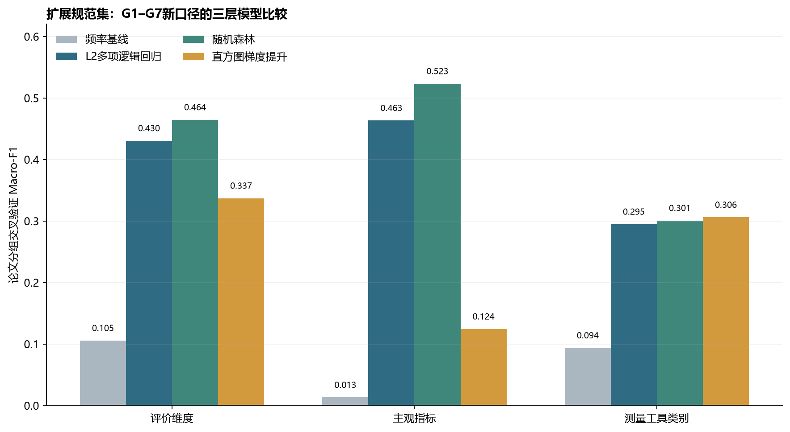
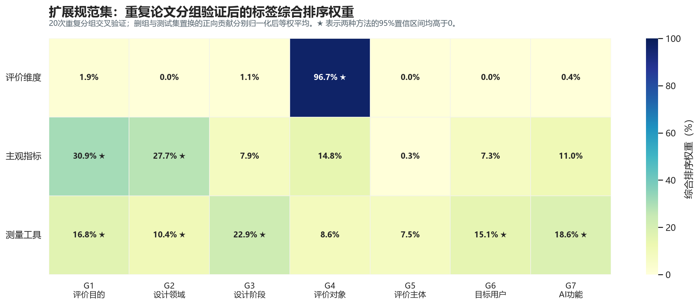
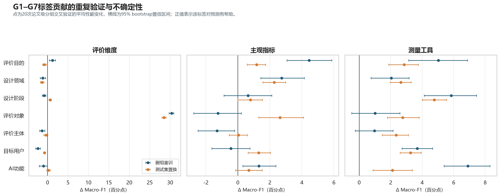
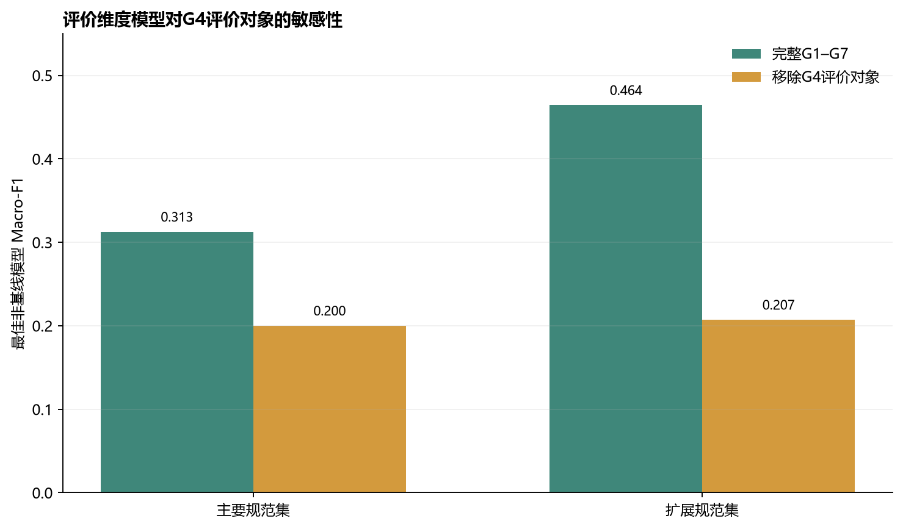
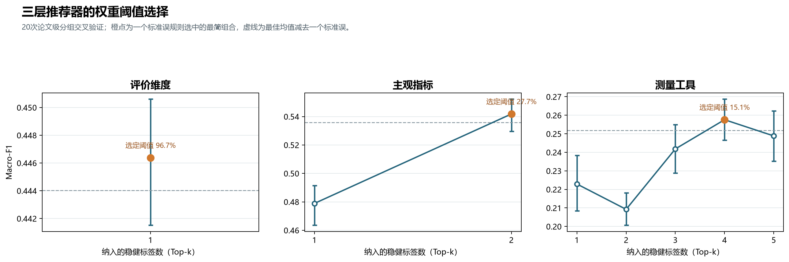

# RQ3：G1–G7情景标签重新提取与三层推荐建模

## 1. 最终情景标签口径

本轮仅保留以下七组情景标签。旧模型中的效果主张形式、数据源、评价环境、可行性约束、AI角色和设计任务不再作为RQ3输入。

| 标签组 | 编码内容 |
|---|---|
| G1 评价目的 | P1价值引出与标准建构；P2模型监督、校准与代理目标；P3形成性反馈与迭代引导；P4总结性验证与比较 |
| G2 设计领域 | 视觉传播；工业／产品；时装；室内；服务；UI/UX设计 |
| G3 设计阶段 | 研究；构思；原型制作与测试；实施 |
| G4 评价对象 | 设计成果或解决方案；设计任务或工作流程；AI辅助设计系统或界面；人的状态或能力；人机协作关系 |
| G5 评价主体 | 设计任务执行者；设计成果使用者；外部领域专家；一般公众／非目标人群；内部研究者／系统开发者 |
| G6 目标用户 | 专业设计从业者；设计学习者／新手设计者；非专业创作者 |
| G7 AI功能 | 识别需求；知识检索；方案生成；原型实现；评估反馈；迭代优化 |

“目标用户”仅指直接使用AI辅助设计工作流的人。原U4组织／团队、U5其他专业人员和U6设计成果终端用户没有并入新的G6。设计成果使用者仅在其实际作出评价判断时进入G5。

## 2. 数据重新提取

重新提取以490条候选评价证据链为底表，并保留此前JCSEE规范性审查得到的两个分析集：

| 分析集 | 证据链 | 工具实例 | 用途 |
|---|---:|---:|---|
| 主要规范集 | 48 | 54 | 更严格的验证和高置信解释 |
| 扩展规范集 | 155 | 182 | 模型开发、标签权重和网页推荐 |

七组标签在扩展规范集中的报告完整率为：G1 100.0%、G2 100.0%、G3 100.0%、G4 100.0%、G5 92.9%、G6 96.1%、G7 99.4%。G4和G5均重新编码，原O6“设计成果使用／社会后果”和O7“需求偏好与价值标准”不再作为评价对象。G6只保留工作流直接用户。

## 3. 建模方法

三级推荐目标依次为：

1. 情景标签 → 评价维度；
2. 情景标签＋已确定评价维度 → 主观指标；
3. 情景标签＋已确定评价维度和主观指标 → 测量工具类别。

评价维度和主观指标模型以证据链为观测单位；测量工具模型以工具实例为观测单位。仅保留至少5个观测且来自至少3篇论文的输出类别。所有交叉验证按论文分组，使同一论文的证据链不会同时进入训练集和测试集。比较模型包括频率基线、L2多项逻辑回归、随机森林和直方图梯度提升，以Macro-F1选择该层最佳非基线模型。

标签贡献采用20次不同随机种子的论文级分组交叉验证复算，并同时使用两种检验：每次删除一个G组后重新训练的删组贡献，以及在测试集置换整个G组后的置换贡献。两种贡献均以完整模型Macro-F1减去受扰动模型的Macro-F1表示；只有两种方法的95% bootstrap置信区间均高于0，才称为稳健正向信号。网页的综合排序权重将两种方法的正向平均贡献分别归一化后等权平均。该权重只用于安排标签提问顺序，不表示因果作用或理论重要性。

## 4. 模型结果

### 4.1 主要规范集

| 推荐目标 | n | 论文数 | 类别数 | 最佳模型 | Macro-F1 | Top-2准确率 |
|---|---:|---:|---:|---|---:|---:|
| 评价维度 | 46 | 20 | 4 | 随机森林 | .313 | .858 |
| 主观指标 | 6 | 5 | 1 | 无法建模 | — | — |
| 测量工具类别 | 53 | 21 | 4 | L2多项逻辑回归 | .286 | .716 |

主要规范集仍不能支持主观指标多分类模型：达到最小支持阈值的指标只有A1新颖性，共6条链、5篇论文。

### 4.2 扩展规范集

| 推荐目标 | n | 论文数 | 类别数 | 最佳模型 | Macro-F1 | 频率基线 | Top-2准确率 |
|---|---:|---:|---:|---|---:|---:|---:|
| 评价维度 | 155 | 38 | 5 | 随机森林 | .464 | .105 | .836 |
| 主观指标 | 95 | 27 | 10 | 随机森林 | .523 | .013 | .808 |
| 测量工具类别 | 182 | 38 | 5 | 直方图梯度提升 | .306 | .094 | .630 |

三层模型均明显高于频率基线，但维度和工具模型仍不足以支持“自动给出唯一答案”。网站应继续输出候选排序、证据量和不确定性。

## 5. 扩展规范集的标签组贡献与综合排序权重

| 推荐目标 | 20次重复验证后的综合排序权重 | 两种检验均稳健的标签组 |
|---|---|---|
| 评价维度 | G4评价对象96.7%；G1评价目的1.9%；G3设计阶段1.1%；G7 AI功能0.4%；其余为0 | G4评价对象 |
| 主观指标 | G1评价目的30.9%；G2设计领域27.7%；G4评价对象14.8%；G7 AI功能11.0%；G3设计阶段7.9%；G6目标用户7.3%；G5评价主体0.3% | G1评价目的、G2设计领域 |
| 测量工具类别 | G3设计阶段22.9%；G7 AI功能18.6%；G1评价目的16.8%；G6目标用户15.1%；G2设计领域10.4%；G4评价对象8.6%；G5评价主体7.5% | G1、G2、G3、G6、G7 |

原图中“主观指标—G6目标用户100%”是旧计算口径造成的归一化假象。旧图只基于一次论文分组交叉验证；负贡献截为0后，该行仅剩G6一个很小的正值（ΔMacro-F1=.019），因此被归一化为100%，但其95%区间[-.008, .065]跨0。

重复验证后，主观指标层G6的删组均值为-.004，95%区间跨0，因而撤回其100%结论。该层稳定信号转为G1评价目的和G2设计领域。评价维度层G4在删组与置换检验中都保持很高贡献；测量工具层的稳定信号分布在G1、G2、G3、G6和G7。图中星号表示两种检验的95%区间均高于0。

配套稳健性图报告未经归一化的ΔMacro-F1及95%区间，作为统计解释的主要依据：

## 6. G4评价对象的结构重叠敏感性

G4的五类评价对象与A–E评价维度存在明显语义对应，例如“人的状态或能力”与C维度、“人机协作关系”与D维度。因此，G4的高权重既包含有用的任务路由信息，也可能包含定义接近带来的预测优势。

移除G4后，主要规范集维度模型的最佳Macro-F1由.313下降至.200；扩展规范集由.464下降至.207。20次重复验证中，删组重训平均下降30.4个百分点，测试集置换平均下降28.5个百分点。论文中应把G4解释为维度选择的首要入口，同时明确它与目标变量具有结构邻近性，不能把96.7%的综合排序权重写成因果效应或一般化理论权重。

## 7. 更新后的网页渐进逻辑

网页仍采用三层渐进披露。首先在双重稳健标签内按综合权重构造Top-k组合，再通过20次论文级分组交叉验证和一个标准误规则，选择性能基本不下降的最简组合。该组合中最低权重构成本层阈值。推荐器只显示并使用同时稳健且达到本层阈值的核心标签；其他G组不在界面显示，也不在后台参与匹配与排序：

1. **评价维度层，阈值96.7%**：只使用G4评价对象；
2. **主观指标层，阈值27.7%**：只使用G1评价目的和G2设计领域；
3. **测量工具层，阈值15.1%**：只使用G3设计阶段、G7 AI功能、G1评价目的和G6目标用户。

低于阈值或未通过双重稳健检验的标签仍保留在分析文件中作为敏感性结果，但不属于推荐器输入。

主要规范集首先用于检索；若主要规范集没有达到至少3条证据且来自至少2篇论文，则回退到扩展规范集并标注证据等级。所有推荐保留原文证据链和支持论文数。

## 8. 可复核文件

- `evidence_chains_context_g1_g7.csv`：490条证据链及新G1–G7标签；
- `main_normative_chains_g1_g7.csv`、`expanded_normative_chains_g1_g7.csv`：两个规范集输入；
- `rq3_model_comparison_g1_g7.csv`：各层模型交叉验证；
- `rq3_label_group_weights_g1_g7.csv`：旧版单次逐组消融结果，仅供追溯，不再用于网页；
- `rq3_dimension_weight_stability.csv`、`rq3_indicator_weight_stability.csv`、`rq3_tool_weight_stability.csv`：20次重复验证的两种贡献及区间；
- `rq3_label_group_priority_stable.csv`：三层合并结果与综合排序权重；
- `rq3_label_group_weights_stable.csv`：网页当前读取的稳健权重表；
- `rq3_recommender_policy.json`：各层核心、补充及阈值排除标签的机器可读配置；
- `rq3_threshold_one_se_curves.csv`、`rq3_threshold_one_se_repeats.csv`、`rq3_threshold_one_se_folds.csv`：阈值选择的组合级、重复级和折级结果；
- `rq3_threshold_one_se_selected.json`：一个标准误规则选定的三层阈值；
- `RQ3三层推荐器最佳权重阈值.md`：阈值计算过程和最终结果；
- `RQ3标签权重热力图核验与更正.md`：100%结果的核验、更正与解释；
- `rq3_context_associations_g1_g7.csv`：G1–G7与维度、指标、工具的Fisher检验、lift和BH校正；
- `rq3_dimension_without_g4_sensitivity.csv`：移除评价对象的敏感性分析；
- `rq3_context_completeness_g1_g7.csv`：标签完整率；
- `summary_g1_g7.json`：标签定义、样本量和建模元数据。

评价对象和评价主体的重新编码规则已逐链保存在`object_recode_rule`和`evaluator_recode_rule`字段中。正式发表前仍应由第二编码者盲审这些新字段并报告一致性。
