# RQ1：Perceived Effect 评价证据的分布

评价维度、主观指标与测量工具的总体分布、年代趋势及其在设计领域与设计阶段中的分布

整合日期：2026-10-27

# 1. 研究问题与分析单位

RQ1回答：在125篇AI-assisted Design workflow全文论文中，研究者评价了哪些Perceived Effect，采用了哪些主观指标和测量工具；这些选择如何随发表年代变化，并如何分布在设计领域与设计阶段中。

| 数据层级 | 数量 | RQ1用途 | 分母说明 |
| --- | --- | --- | --- |
| 全文论文 | 125 | 发表年份、论文背景 | 同篇论文可含多个案例 |
| 评价案例 | 158 | 连接论文与证据链的实施情境 | 同一案例可形成多条证据链 |
| 候选评价证据记录 | 490 | 保留全部可追溯候选记录 | 不等于全部均完成分类映射 |
| 已映射评价维度 | 432 | 五类评价维度分布 | A–E互斥；58条维度未映射 |
| 完整可建模证据链 | 426 | 36类主观指标分布 | 已完成主张—构念—指标—测量对应 |
| 测量工具实例 | 600 | 工具使用强度 | 一条证据链可使用多个工具 |
| 可判定工具实例 | 584 | M1–M5工具分布 | 16个实例保留UNMAPPED |

领域和阶段允许多选。将一条链展开到多个领域或阶段后，情境交叉表中的分配数会高于证据链数，因此这些表的百分比以相应情境内的展开分配数为分母，不能与432或426直接相加。

# 2. 评价维度：总体分布与年代趋势

| 评价维度 | 证据链数 | 占432条已映射维度链 |
| --- | --- | --- |
| A 设计成果质量 | 136 | 31.5% |
| B 设计过程效能 | 41 | 9.5% |
| C 设计者认知、情感与能力 | 101 | 23.4% |
| D 人机交互体验 | 91 | 21.1% |
| E 社会情境价值 | 63 | 14.6% |

设计成果质量是最常见的评价维度，其后是设计者认知、情感与能力、人机交互体验、社会情境价值和设计过程效能。年度数量在2024年后明显增长，首先反映语料库发表规模扩大；因此趋势同时比较数量与当年构成比。二项GLM显示，C类每年优势比为0.949（BH校正q=.050），D类为0.983（q=.025），A、B、E未见校正后显著单调变化。

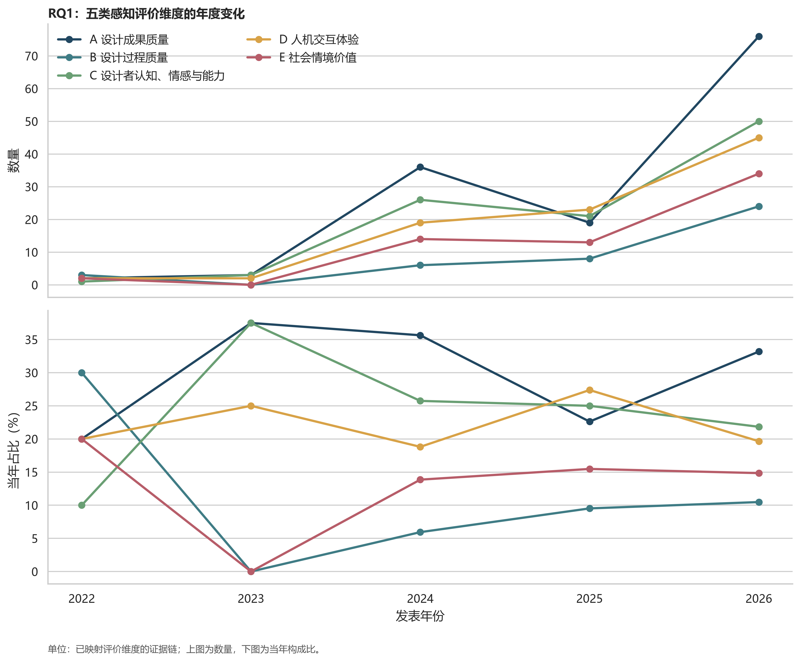

*图1  五类评价维度的年度数量与年度构成*

### 图1对应数据表

单元格为证据链数n（该年度已映射维度证据链中的百分比）。

| 年份 | 当年分母 | A 设计成果质量 | B 设计过程效能 | C 设计者认知、情感与能力 | D 人机交互体验 | E 社会情境价值 |
| --- | --- | --- | --- | --- | --- | --- |
| 2022 | 10 | 2 (20.0%) | 3 (30.0%) | 1 (10.0%) | 2 (20.0%) | 2 (20.0%) |
| 2023 | 8 | 3 (37.5%) | 0 (0.0%) | 3 (37.5%) | 2 (25.0%) | 0 (0.0%) |
| 2024 | 101 | 36 (35.6%) | 6 (5.9%) | 26 (25.7%) | 19 (18.8%) | 14 (13.9%) |
| 2025 | 84 | 19 (22.6%) | 8 (9.5%) | 21 (25.0%) | 23 (27.4%) | 13 (15.5%) |
| 2026 | 229 | 76 (33.2%) | 24 (10.5%) | 50 (21.8%) | 45 (19.7%) | 34 (14.8%) |

# 3. 主观指标：总体分布与年代趋势

| 排名 | 主观指标 | 证据链数 |
| --- | --- | --- |
| 1 | A3 适用性 | 36 |
| 2 | A1 新颖性 | 32 |
| 3 | C5 愉悦 | 28 |
| 4 | D8 沟通、协调、冲突与共同理解 | 24 |
| 5 | A4 可行性 | 23 |
| 6 | A2 美观性 | 20 |
| 7 | D3 控制感 | 20 |
| 8 | C1 灵感刺激 | 18 |
| 9 | C2 知识获得 | 18 |
| 10 | E2 用户需求、情境与人群适配 | 17 |
| 11 | D1 易用性 | 16 |
| 12 | B5 过程连续性 | 14 |

高频指标主要集中在适用性、新颖性、愉悦、沟通协作、可行性、美观性和控制感。总量不少于10且模型可稳定估计的上升指标包括C8能力扩展（OR=1.290）、C2知识获得（1.276）、E7商业／品牌／市场价值（1.231）、A2美观性（1.143）、B2工作负荷（1.105）和D7角色、分工与贡献公平（1.105）；下降指标包括C1灵感刺激（0.618）、D3控制感（0.843）、C5愉悦（0.868）、D8沟通协作（0.909）和A6全面性（0.912）。这些变化是文献测量选择的变化，不是AI辅助设计真实效应的年代变化。

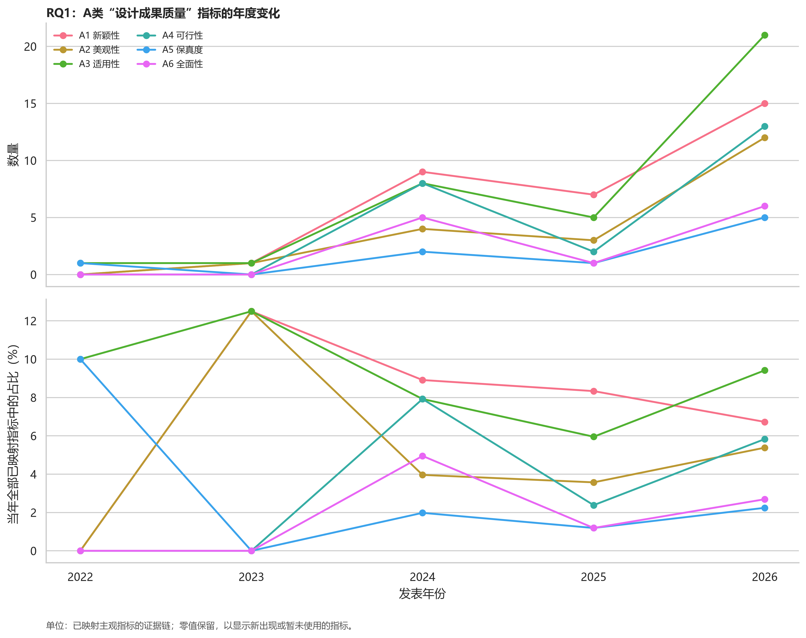

*图2A  A类设计成果质量指标的年度变化*

### 图2A对应数据表

单元格为证据链数n（该年度已映射主观指标证据链中的百分比）。

| 年份 | 当年分母 | A1 新颖性 | A2 美观性 | A3 适用性 | A4 可行性 | A5 保真度 | A6 全面性 |
| --- | --- | --- | --- | --- | --- | --- | --- |
| 2022 | 10 | 0 (0.0%) | 0 (0.0%) | 1 (10.0%) | 0 (0.0%) | 1 (10.0%) | 0 (0.0%) |
| 2023 | 8 | 1 (12.5%) | 1 (12.5%) | 1 (12.5%) | 0 (0.0%) | 0 (0.0%) | 0 (0.0%) |
| 2024 | 101 | 9 (8.9%) | 4 (4.0%) | 8 (7.9%) | 8 (7.9%) | 2 (2.0%) | 5 (5.0%) |
| 2025 | 84 | 7 (8.3%) | 3 (3.6%) | 5 (6.0%) | 2 (2.4%) | 1 (1.2%) | 1 (1.2%) |
| 2026 | 223 | 15 (6.7%) | 12 (5.4%) | 21 (9.4%) | 13 (5.8%) | 5 (2.2%) | 6 (2.7%) |

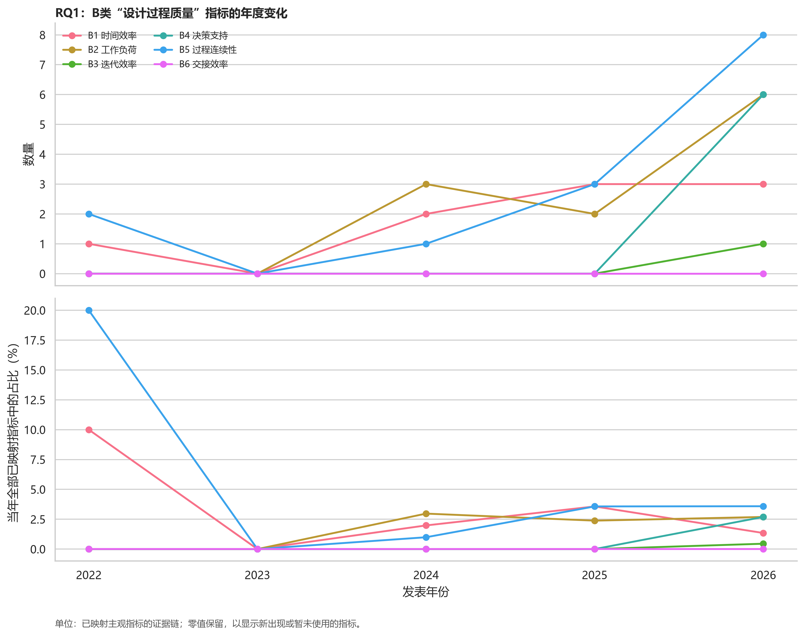

*图2B  B类设计过程效能指标的年度变化*

### 图2B对应数据表

单元格为证据链数n（该年度已映射主观指标证据链中的百分比）。

| 年份 | 当年分母 | B1 时间效率 | B2 工作负荷 | B3 迭代效率 | B4 决策支持 | B5 过程连续性 | B6 交接效率 |
| --- | --- | --- | --- | --- | --- | --- | --- |
| 2022 | 10 | 1 (10.0%) | 0 (0.0%) | 0 (0.0%) | 0 (0.0%) | 2 (20.0%) | 0 (0.0%) |
| 2023 | 8 | 0 (0.0%) | 0 (0.0%) | 0 (0.0%) | 0 (0.0%) | 0 (0.0%) | 0 (0.0%) |
| 2024 | 101 | 2 (2.0%) | 3 (3.0%) | 0 (0.0%) | 0 (0.0%) | 1 (1.0%) | 0 (0.0%) |
| 2025 | 84 | 3 (3.6%) | 2 (2.4%) | 0 (0.0%) | 0 (0.0%) | 3 (3.6%) | 0 (0.0%) |
| 2026 | 223 | 3 (1.3%) | 6 (2.7%) | 1 (0.4%) | 6 (2.7%) | 8 (3.6%) | 0 (0.0%) |

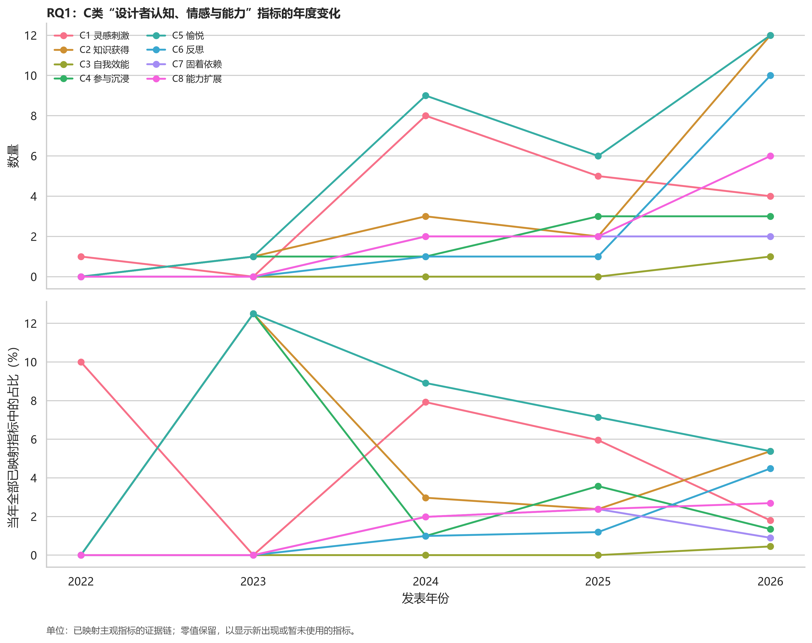

*图2C  C类设计者认知、情感与能力指标的年度变化*

### 图2C对应数据表

单元格为证据链数n（该年度已映射主观指标证据链中的百分比）。

| 年份 | 当年分母 | C1 灵感刺激 | C2 知识获得 | C3 自我效能 | C4 参与沉浸 | C5 愉悦 | C6 反思 | C7 固着依赖 | C8 能力扩展 |
| --- | --- | --- | --- | --- | --- | --- | --- | --- | --- |
| 2022 | 10 | 1 (10.0%) | 0 (0.0%) | 0 (0.0%) | 0 (0.0%) | 0 (0.0%) | 0 (0.0%) | 0 (0.0%) | 0 (0.0%) |
| 2023 | 8 | 0 (0.0%) | 1 (12.5%) | 0 (0.0%) | 1 (12.5%) | 1 (12.5%) | 0 (0.0%) | 0 (0.0%) | 0 (0.0%) |
| 2024 | 101 | 8 (7.9%) | 3 (3.0%) | 0 (0.0%) | 1 (1.0%) | 9 (8.9%) | 1 (1.0%) | 2 (2.0%) | 2 (2.0%) |
| 2025 | 84 | 5 (6.0%) | 2 (2.4%) | 0 (0.0%) | 3 (3.6%) | 6 (7.1%) | 1 (1.2%) | 2 (2.4%) | 2 (2.4%) |
| 2026 | 223 | 4 (1.8%) | 12 (5.4%) | 1 (0.4%) | 3 (1.3%) | 12 (5.4%) | 10 (4.5%) | 2 (0.9%) | 6 (2.7%) |

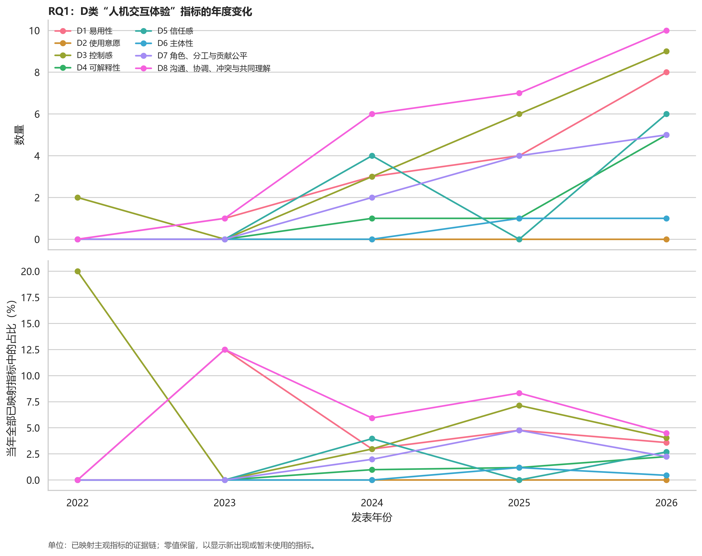

*图2D  D类人机交互体验指标的年度变化*

### 图2D对应数据表

单元格为证据链数n（该年度已映射主观指标证据链中的百分比）。

| 年份 | 当年分母 | D1 易用性 | D2 使用意愿 | D3 控制感 | D4 可解释性 | D5 信任感 | D6 主体性 | D7 角色、分工与贡献公平 | D8 沟通、协调、冲突与共同理解 |
| --- | --- | --- | --- | --- | --- | --- | --- | --- | --- |
| 2022 | 10 | 0 (0.0%) | 0 (0.0%) | 2 (20.0%) | 0 (0.0%) | 0 (0.0%) | 0 (0.0%) | 0 (0.0%) | 0 (0.0%) |
| 2023 | 8 | 1 (12.5%) | 0 (0.0%) | 0 (0.0%) | 0 (0.0%) | 0 (0.0%) | 0 (0.0%) | 0 (0.0%) | 1 (12.5%) |
| 2024 | 101 | 3 (3.0%) | 0 (0.0%) | 3 (3.0%) | 1 (1.0%) | 4 (4.0%) | 0 (0.0%) | 2 (2.0%) | 6 (5.9%) |
| 2025 | 84 | 4 (4.8%) | 0 (0.0%) | 6 (7.1%) | 1 (1.2%) | 0 (0.0%) | 1 (1.2%) | 4 (4.8%) | 7 (8.3%) |
| 2026 | 223 | 8 (3.6%) | 0 (0.0%) | 9 (4.0%) | 5 (2.2%) | 6 (2.7%) | 1 (0.4%) | 5 (2.2%) | 10 (4.5%) |

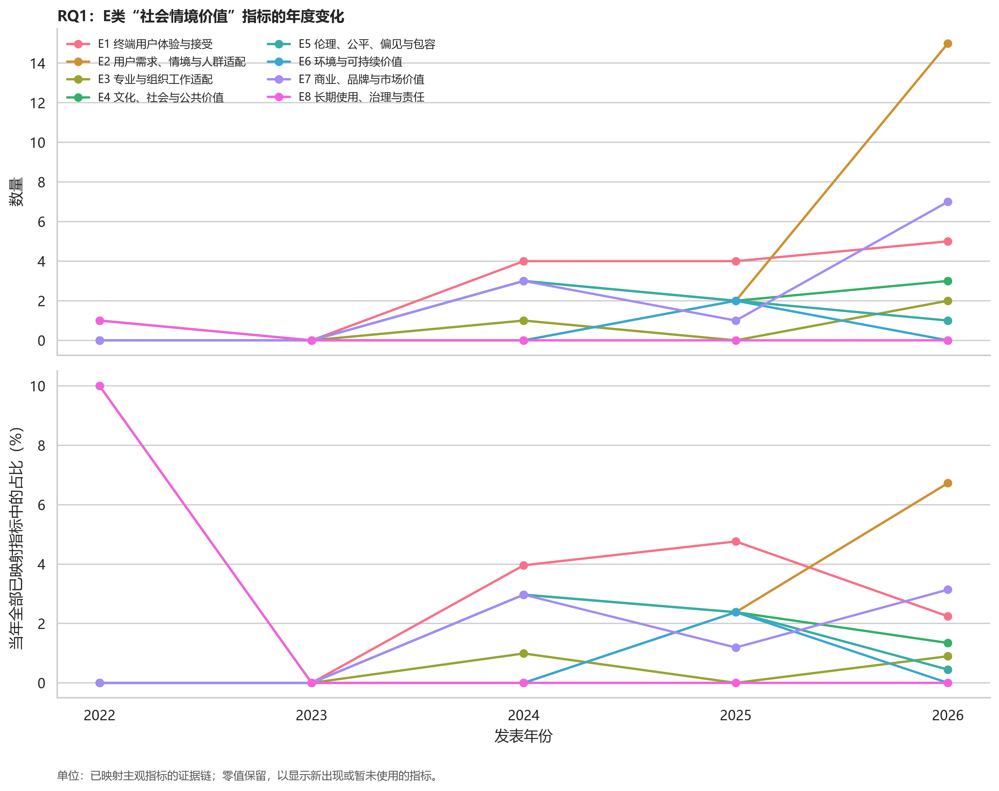

*图2E  E类社会情境价值指标的年度变化*

### 图2E对应数据表

单元格为证据链数n（该年度已映射主观指标证据链中的百分比）。

| 年份 | 当年分母 | E1 终端用户体验与接受 | E2 用户需求、情境与人群适配 | E3 专业与组织工作适配 | E4 文化、社会与公共价值 | E5 伦理、公平、偏见与包容 | E6 环境与可持续价值 | E7 商业、品牌与市场价值 | E8 长期使用、治理与责任 |
| --- | --- | --- | --- | --- | --- | --- | --- | --- | --- |
| 2022 | 10 | 0 (0.0%) | 0 (0.0%) | 0 (0.0%) | 1 (10.0%) | 0 (0.0%) | 0 (0.0%) | 0 (0.0%) | 1 (10.0%) |
| 2023 | 8 | 0 (0.0%) | 0 (0.0%) | 0 (0.0%) | 0 (0.0%) | 0 (0.0%) | 0 (0.0%) | 0 (0.0%) | 0 (0.0%) |
| 2024 | 101 | 4 (4.0%) | 0 (0.0%) | 1 (1.0%) | 3 (3.0%) | 3 (3.0%) | 0 (0.0%) | 3 (3.0%) | 0 (0.0%) |
| 2025 | 84 | 4 (4.8%) | 2 (2.4%) | 0 (0.0%) | 2 (2.4%) | 2 (2.4%) | 2 (2.4%) | 1 (1.2%) | 0 (0.0%) |
| 2026 | 223 | 5 (2.2%) | 15 (6.7%) | 2 (0.9%) | 3 (1.3%) | 1 (0.4%) | 0 (0.0%) | 7 (3.1%) | 0 (0.0%) |

# 4. 测量工具：总体分布与年代趋势

| 代码 | 互斥工具类别 | 工具实例数 | 占584个可判定实例 |
| --- | --- | --- | --- |
| M1 | 标准化具名量表 | 97 | 16.6% |
| M2 | 自编结构化评分工具 | 180 | 30.8% |
| M3 | 定性言语引出工具 | 130 | 22.3% |
| M4 | 非量表型结构化问卷 | 112 | 19.2% |
| M5 | 既有感知资料分析 | 65 | 11.1% |

M2是最常见工具，并呈上升趋势（每年OR=1.336）。M1、M3和M5分别呈下降趋势（OR=0.854、0.861、0.914），M4未见稳定单调趋势。结果表明研究越来越依赖针对特定系统或任务的自编评分；其情境贴合度可能较高，但跨研究可比性与累积效度证据较弱。

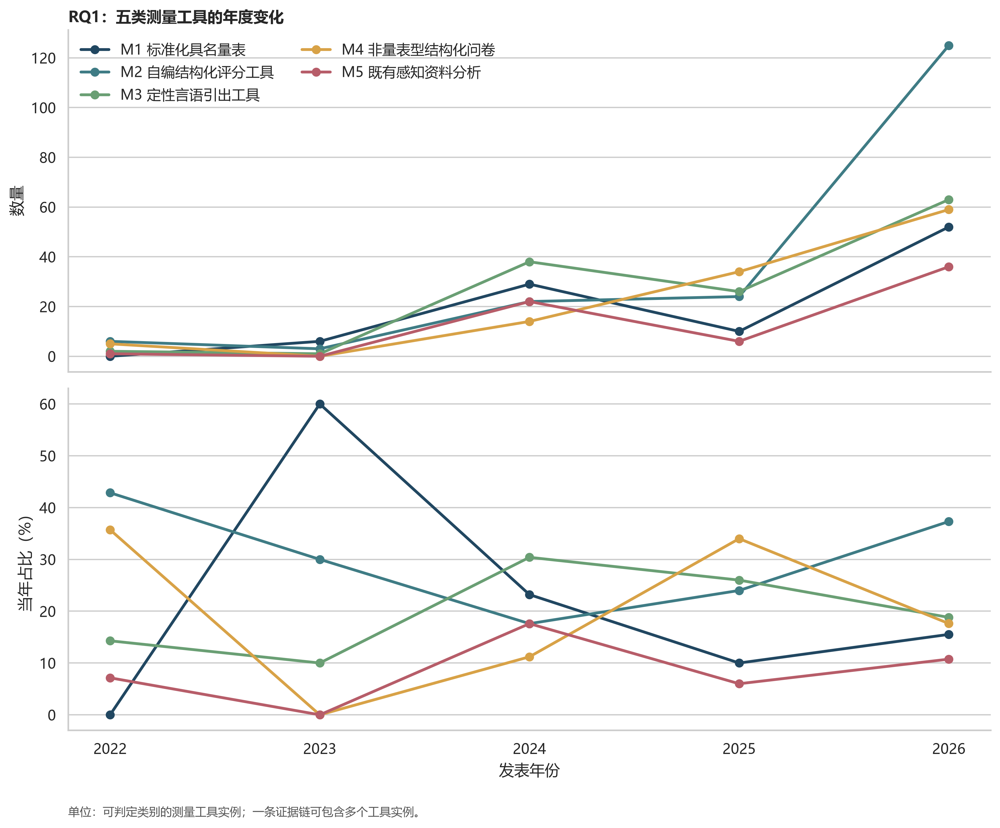

*图3  五类测量工具的年度数量与年度构成*

### 图3对应数据表

单元格为工具实例数n（该年度可判定工具实例中的百分比）。

| 年份 | 当年分母 | M1 标准化具名量表 | M2 自编结构化评分工具 | M3 定性言语引出工具 | M4 非量表型结构化问卷 | M5 既有感知资料分析 |
| --- | --- | --- | --- | --- | --- | --- |
| 2022 | 14 | 0 (0.0%) | 6 (42.9%) | 2 (14.3%) | 5 (35.7%) | 1 (7.1%) |
| 2023 | 10 | 6 (60.0%) | 3 (30.0%) | 1 (10.0%) | 0 (0.0%) | 0 (0.0%) |
| 2024 | 125 | 29 (23.2%) | 22 (17.6%) | 38 (30.4%) | 14 (11.2%) | 22 (17.6%) |
| 2025 | 100 | 10 (10.0%) | 24 (24.0%) | 26 (26.0%) | 34 (34.0%) | 6 (6.0%) |
| 2026 | 335 | 52 (15.5%) | 125 (37.3%) | 63 (18.8%) | 59 (17.6%) | 36 (10.7%) |

# 5. 设计领域与设计阶段中的分布

## 5.1 评价维度

设计领域×评价维度：χ²(20)=27.54，p=.121，Cramér’s V=.112；设计阶段×评价维度：χ²(12)=13.20，p=.355，V=.066。两者均未达到统计显著，效应量较小，说明仅凭领域或阶段不足以决定一级评价维度。

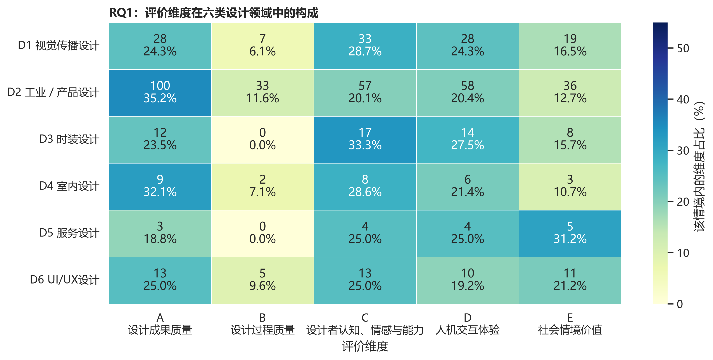

*图4A  评价维度在六类设计领域中的构成*

### 图4A对应数据表

单元格为n（情境内百分比）。

| 结果类别 | D1 视觉传播 | D2 工业／产品 | D3 时装 | D4 室内 | D5 服务 | D6 UI/UX |
| --- | --- | --- | --- | --- | --- | --- |
| A 设计成果质量 | 28 (24.3%) | 100 (35.2%) | 12 (23.5%) | 9 (32.1%) | 3 (18.8%) | 13 (25.0%) |
| B 设计过程效能 | 7 (6.1%) | 33 (11.6%) | 0 (0.0%) | 2 (7.1%) | 0 (0.0%) | 5 (9.6%) |
| C 设计者认知、情感与能力 | 33 (28.7%) | 57 (20.1%) | 17 (33.3%) | 8 (28.6%) | 4 (25.0%) | 13 (25.0%) |
| D 人机交互体验 | 28 (24.3%) | 58 (20.4%) | 14 (27.5%) | 6 (21.4%) | 4 (25.0%) | 10 (19.2%) |
| E 社会情境价值 | 19 (16.5%) | 36 (12.7%) | 8 (15.7%) | 3 (10.7%) | 5 (31.2%) | 11 (21.2%) |

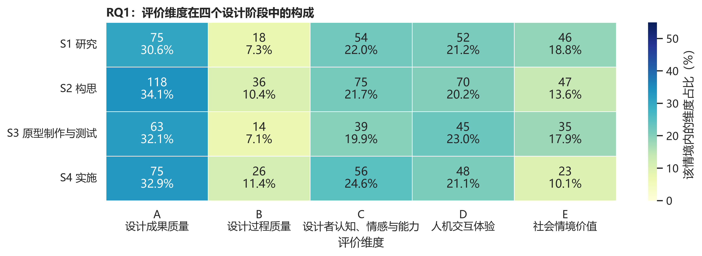

*图4B  评价维度在四个设计阶段中的构成*

### 图4B对应数据表

单元格为n（情境内百分比）。

| 结果类别 | S1 研究 | S2 构思 | S3 原型制作与测试 | S4 实施 |
| --- | --- | --- | --- | --- |
| A 设计成果质量 | 75 (30.6%) | 118 (34.1%) | 63 (32.1%) | 75 (32.9%) |
| B 设计过程效能 | 18 (7.3%) | 36 (10.4%) | 14 (7.1%) | 26 (11.4%) |
| C 设计者认知、情感与能力 | 54 (22.0%) | 75 (21.7%) | 39 (19.9%) | 56 (24.6%) |
| D 人机交互体验 | 52 (21.2%) | 70 (20.2%) | 45 (23.0%) | 48 (21.1%) |
| E 社会情境价值 | 46 (18.8%) | 47 (13.6%) | 35 (17.9%) | 23 (10.1%) |

## 5.2 主观指标

设计领域×主观指标：χ²(165)=175.86，p=.267，V=.255；设计阶段×主观指标：χ²(99)=73.58，p=.974，V=.156。由于领域表84.8%、阶段表41.2%的期望频数低于5，这些检验主要用于探索，不宜作强推断。指标层具有更细的局部差异，但样本稀疏，适合在推荐系统中作为候选证据而非硬规则。

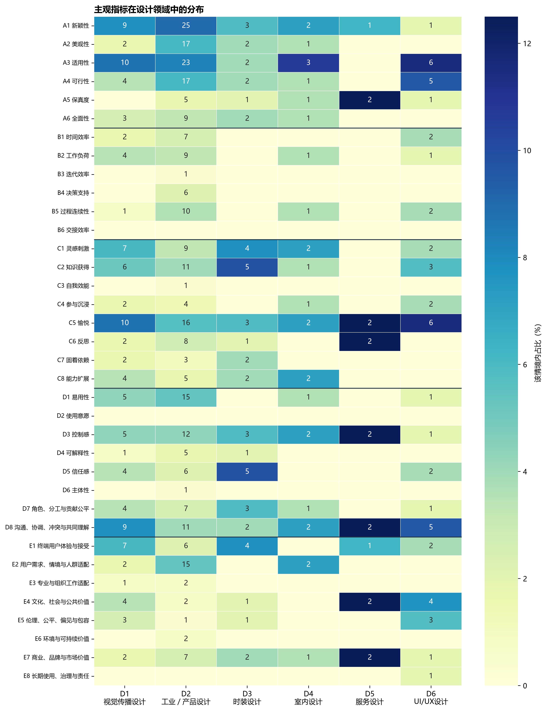

*图5A  主观指标在六类设计领域中的分布*

### 图5A对应数据表

单元格为n（情境内百分比）。

| 结果类别 | D1 视觉传播 | D2 工业／产品 | D3 时装 | D4 室内 | D5 服务 | D6 UI/UX |
| --- | --- | --- | --- | --- | --- | --- |
| A1 新颖性 | 9 (7.8%) | 25 (9.0%) | 3 (5.9%) | 2 (7.1%) | 1 (6.2%) | 1 (1.9%) |
| A2 美观性 | 2 (1.7%) | 17 (6.1%) | 2 (3.9%) | 1 (3.6%) | 0 (0.0%) | 0 (0.0%) |
| A3 适用性 | 10 (8.7%) | 23 (8.3%) | 2 (3.9%) | 3 (10.7%) | 0 (0.0%) | 6 (11.5%) |
| A4 可行性 | 4 (3.5%) | 17 (6.1%) | 2 (3.9%) | 1 (3.6%) | 0 (0.0%) | 5 (9.6%) |
| A5 保真度 | 0 (0.0%) | 5 (1.8%) | 1 (2.0%) | 1 (3.6%) | 2 (12.5%) | 1 (1.9%) |
| A6 全面性 | 3 (2.6%) | 9 (3.2%) | 2 (3.9%) | 1 (3.6%) | 0 (0.0%) | 0 (0.0%) |
| B1 时间效率 | 2 (1.7%) | 7 (2.5%) | 0 (0.0%) | 0 (0.0%) | 0 (0.0%) | 2 (3.8%) |
| B2 工作负荷 | 4 (3.5%) | 9 (3.2%) | 0 (0.0%) | 1 (3.6%) | 0 (0.0%) | 1 (1.9%) |
| B3 迭代效率 | 0 (0.0%) | 1 (0.4%) | 0 (0.0%) | 0 (0.0%) | 0 (0.0%) | 0 (0.0%) |
| B4 决策支持 | 0 (0.0%) | 6 (2.2%) | 0 (0.0%) | 0 (0.0%) | 0 (0.0%) | 0 (0.0%) |
| B5 过程连续性 | 1 (0.9%) | 10 (3.6%) | 0 (0.0%) | 1 (3.6%) | 0 (0.0%) | 2 (3.8%) |
| B6 交接效率 | 0 (0.0%) | 0 (0.0%) | 0 (0.0%) | 0 (0.0%) | 0 (0.0%) | 0 (0.0%) |
| C1 灵感刺激 | 7 (6.1%) | 9 (3.2%) | 4 (7.8%) | 2 (7.1%) | 0 (0.0%) | 2 (3.8%) |
| C2 知识获得 | 6 (5.2%) | 11 (4.0%) | 5 (9.8%) | 1 (3.6%) | 0 (0.0%) | 3 (5.8%) |
| C3 自我效能 | 0 (0.0%) | 1 (0.4%) | 0 (0.0%) | 0 (0.0%) | 0 (0.0%) | 0 (0.0%) |
| C4 参与沉浸 | 2 (1.7%) | 4 (1.4%) | 0 (0.0%) | 1 (3.6%) | 0 (0.0%) | 2 (3.8%) |
| C5 愉悦 | 10 (8.7%) | 16 (5.8%) | 3 (5.9%) | 2 (7.1%) | 2 (12.5%) | 6 (11.5%) |
| C6 反思 | 2 (1.7%) | 8 (2.9%) | 1 (2.0%) | 0 (0.0%) | 2 (12.5%) | 0 (0.0%) |
| C7 固着依赖 | 2 (1.7%) | 3 (1.1%) | 2 (3.9%) | 0 (0.0%) | 0 (0.0%) | 0 (0.0%) |
| C8 能力扩展 | 4 (3.5%) | 5 (1.8%) | 2 (3.9%) | 2 (7.1%) | 0 (0.0%) | 0 (0.0%) |
| D1 易用性 | 5 (4.3%) | 15 (5.4%) | 0 (0.0%) | 1 (3.6%) | 0 (0.0%) | 1 (1.9%) |
| D2 使用意愿 | 0 (0.0%) | 0 (0.0%) | 0 (0.0%) | 0 (0.0%) | 0 (0.0%) | 0 (0.0%) |
| D3 控制感 | 5 (4.3%) | 12 (4.3%) | 3 (5.9%) | 2 (7.1%) | 2 (12.5%) | 1 (1.9%) |
| D4 可解释性 | 1 (0.9%) | 5 (1.8%) | 1 (2.0%) | 0 (0.0%) | 0 (0.0%) | 0 (0.0%) |
| D5 信任感 | 4 (3.5%) | 6 (2.2%) | 5 (9.8%) | 0 (0.0%) | 0 (0.0%) | 2 (3.8%) |
| D6 主体性 | 0 (0.0%) | 1 (0.4%) | 0 (0.0%) | 0 (0.0%) | 0 (0.0%) | 0 (0.0%) |
| D7 角色、分工与贡献公平 | 4 (3.5%) | 7 (2.5%) | 3 (5.9%) | 1 (3.6%) | 0 (0.0%) | 1 (1.9%) |
| D8 沟通、协调、冲突与共同理解 | 9 (7.8%) | 11 (4.0%) | 2 (3.9%) | 2 (7.1%) | 2 (12.5%) | 5 (9.6%) |
| E1 终端用户体验与接受 | 7 (6.1%) | 6 (2.2%) | 4 (7.8%) | 0 (0.0%) | 1 (6.2%) | 2 (3.8%) |
| E2 用户需求、情境与人群适配 | 2 (1.7%) | 15 (5.4%) | 0 (0.0%) | 2 (7.1%) | 0 (0.0%) | 0 (0.0%) |
| E3 专业与组织工作适配 | 1 (0.9%) | 2 (0.7%) | 0 (0.0%) | 0 (0.0%) | 0 (0.0%) | 0 (0.0%) |
| E4 文化、社会与公共价值 | 4 (3.5%) | 2 (0.7%) | 1 (2.0%) | 0 (0.0%) | 2 (12.5%) | 4 (7.7%) |
| E5 伦理、公平、偏见与包容 | 3 (2.6%) | 1 (0.4%) | 1 (2.0%) | 0 (0.0%) | 0 (0.0%) | 3 (5.8%) |
| E6 环境与可持续价值 | 0 (0.0%) | 2 (0.7%) | 0 (0.0%) | 0 (0.0%) | 0 (0.0%) | 0 (0.0%) |
| E7 商业、品牌与市场价值 | 2 (1.7%) | 7 (2.5%) | 2 (3.9%) | 1 (3.6%) | 2 (12.5%) | 1 (1.9%) |
| E8 长期使用、治理与责任 | 0 (0.0%) | 0 (0.0%) | 0 (0.0%) | 0 (0.0%) | 0 (0.0%) | 1 (1.9%) |

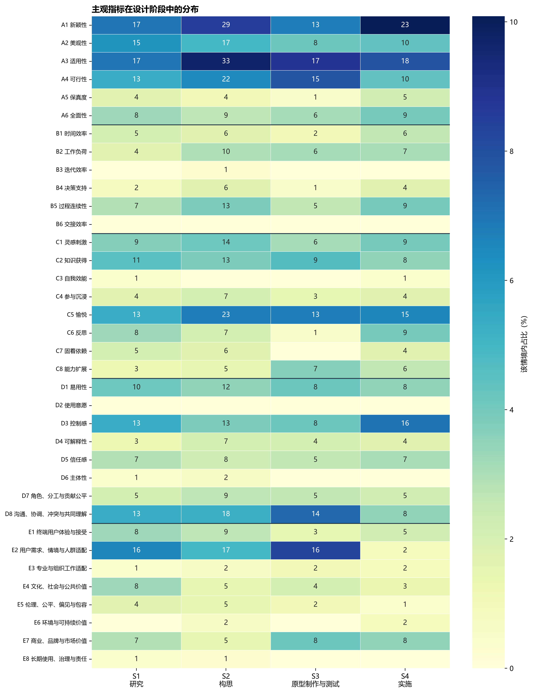

*图5B  主观指标在四个设计阶段中的分布*

### 图5B对应数据表

单元格为n（情境内百分比）。

| 结果类别 | S1 研究 | S2 构思 | S3 原型制作与测试 | S4 实施 |
| --- | --- | --- | --- | --- |
| A1 新颖性 | 17 (7.0%) | 29 (8.5%) | 13 (6.8%) | 23 (10.1%) |
| A2 美观性 | 15 (6.2%) | 17 (5.0%) | 8 (4.2%) | 10 (4.4%) |
| A3 适用性 | 17 (7.0%) | 33 (9.7%) | 17 (8.9%) | 18 (7.9%) |
| A4 可行性 | 13 (5.3%) | 22 (6.5%) | 15 (7.8%) | 10 (4.4%) |
| A5 保真度 | 4 (1.6%) | 4 (1.2%) | 1 (0.5%) | 5 (2.2%) |
| A6 全面性 | 8 (3.3%) | 9 (2.6%) | 6 (3.1%) | 9 (3.9%) |
| B1 时间效率 | 5 (2.1%) | 6 (1.8%) | 2 (1.0%) | 6 (2.6%) |
| B2 工作负荷 | 4 (1.6%) | 10 (2.9%) | 6 (3.1%) | 7 (3.1%) |
| B3 迭代效率 | 0 (0.0%) | 1 (0.3%) | 0 (0.0%) | 0 (0.0%) |
| B4 决策支持 | 2 (0.8%) | 6 (1.8%) | 1 (0.5%) | 4 (1.8%) |
| B5 过程连续性 | 7 (2.9%) | 13 (3.8%) | 5 (2.6%) | 9 (3.9%) |
| B6 交接效率 | 0 (0.0%) | 0 (0.0%) | 0 (0.0%) | 0 (0.0%) |
| C1 灵感刺激 | 9 (3.7%) | 14 (4.1%) | 6 (3.1%) | 9 (3.9%) |
| C2 知识获得 | 11 (4.5%) | 13 (3.8%) | 9 (4.7%) | 8 (3.5%) |
| C3 自我效能 | 1 (0.4%) | 0 (0.0%) | 0 (0.0%) | 1 (0.4%) |
| C4 参与沉浸 | 4 (1.6%) | 7 (2.1%) | 3 (1.6%) | 4 (1.8%) |
| C5 愉悦 | 13 (5.3%) | 23 (6.8%) | 13 (6.8%) | 15 (6.6%) |
| C6 反思 | 8 (3.3%) | 7 (2.1%) | 1 (0.5%) | 9 (3.9%) |
| C7 固着依赖 | 5 (2.1%) | 6 (1.8%) | 0 (0.0%) | 4 (1.8%) |
| C8 能力扩展 | 3 (1.2%) | 5 (1.5%) | 7 (3.6%) | 6 (2.6%) |
| D1 易用性 | 10 (4.1%) | 12 (3.5%) | 8 (4.2%) | 8 (3.5%) |
| D2 使用意愿 | 0 (0.0%) | 0 (0.0%) | 0 (0.0%) | 0 (0.0%) |
| D3 控制感 | 13 (5.3%) | 13 (3.8%) | 8 (4.2%) | 16 (7.0%) |
| D4 可解释性 | 3 (1.2%) | 7 (2.1%) | 4 (2.1%) | 4 (1.8%) |
| D5 信任感 | 7 (2.9%) | 8 (2.4%) | 5 (2.6%) | 7 (3.1%) |
| D6 主体性 | 1 (0.4%) | 2 (0.6%) | 0 (0.0%) | 0 (0.0%) |
| D7 角色、分工与贡献公平 | 5 (2.1%) | 9 (2.6%) | 5 (2.6%) | 5 (2.2%) |
| D8 沟通、协调、冲突与共同理解 | 13 (5.3%) | 18 (5.3%) | 14 (7.3%) | 8 (3.5%) |
| E1 终端用户体验与接受 | 8 (3.3%) | 9 (2.6%) | 3 (1.6%) | 5 (2.2%) |
| E2 用户需求、情境与人群适配 | 16 (6.6%) | 17 (5.0%) | 16 (8.3%) | 2 (0.9%) |
| E3 专业与组织工作适配 | 1 (0.4%) | 2 (0.6%) | 2 (1.0%) | 2 (0.9%) |
| E4 文化、社会与公共价值 | 8 (3.3%) | 5 (1.5%) | 4 (2.1%) | 3 (1.3%) |
| E5 伦理、公平、偏见与包容 | 4 (1.6%) | 5 (1.5%) | 2 (1.0%) | 1 (0.4%) |
| E6 环境与可持续价值 | 0 (0.0%) | 2 (0.6%) | 0 (0.0%) | 2 (0.9%) |
| E7 商业、品牌与市场价值 | 7 (2.9%) | 5 (1.5%) | 8 (4.2%) | 8 (3.5%) |
| E8 长期使用、治理与责任 | 1 (0.4%) | 1 (0.3%) | 0 (0.0%) | 0 (0.0%) |

## 5.3 测量工具

设计领域×测量工具：χ²(20)=260.66，p<.001，V=.300；设计阶段×测量工具：χ²(12)=50.31，p<.001，V=.110。工具选择与领域存在中等关联，与阶段存在较小但显著的关联。领域和阶段因此更适合参与工具层推荐，而不适合单独决定评价维度。

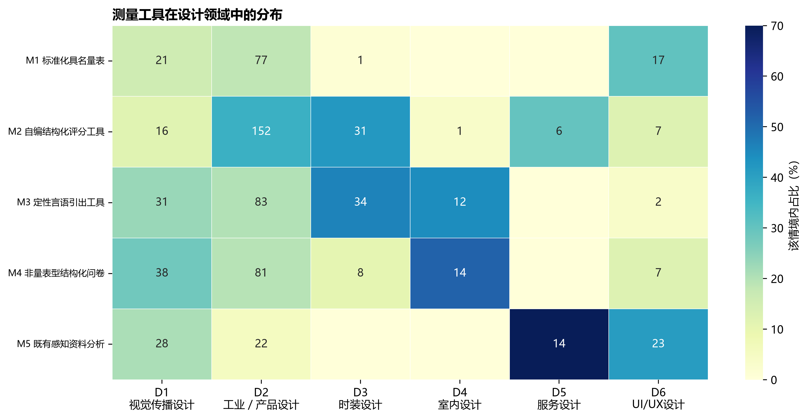

*图6A  测量工具在六类设计领域中的分布*

### 图6A对应数据表

单元格为n（情境内百分比）。

| 结果类别 | D1 视觉传播 | D2 工业／产品 | D3 时装 | D4 室内 | D5 服务 | D6 UI/UX |
| --- | --- | --- | --- | --- | --- | --- |
| M1 标准化具名量表 | 21 (15.7%) | 77 (18.6%) | 1 (1.4%) | 0 (0.0%) | 0 (0.0%) | 17 (30.4%) |
| M2 自编结构化评分工具 | 16 (11.9%) | 152 (36.6%) | 31 (41.9%) | 1 (3.7%) | 6 (30.0%) | 7 (12.5%) |
| M3 定性言语引出工具 | 31 (23.1%) | 83 (20.0%) | 34 (45.9%) | 12 (44.4%) | 0 (0.0%) | 2 (3.6%) |
| M4 非量表型结构化问卷 | 38 (28.4%) | 81 (19.5%) | 8 (10.8%) | 14 (51.9%) | 0 (0.0%) | 7 (12.5%) |
| M5 既有感知资料分析 | 28 (20.9%) | 22 (5.3%) | 0 (0.0%) | 0 (0.0%) | 14 (70.0%) | 23 (41.1%) |

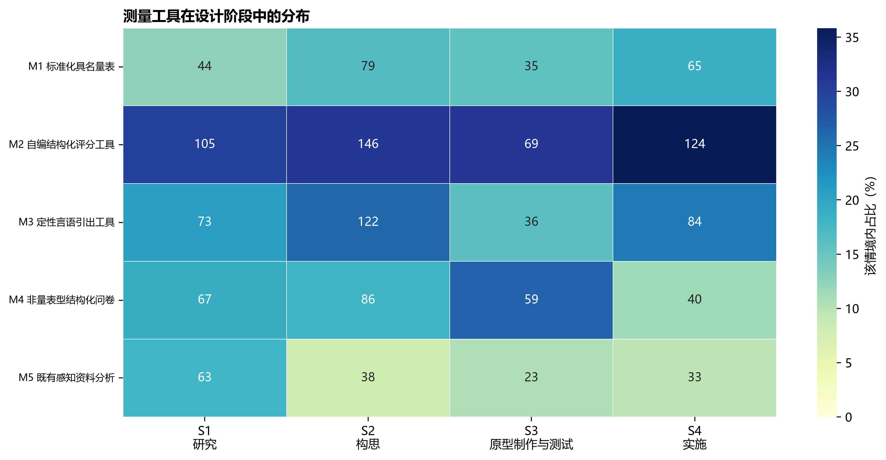

*图6B  测量工具在四个设计阶段中的分布*

### 图6B对应数据表

单元格为n（情境内百分比）。

| 结果类别 | S1 研究 | S2 构思 | S3 原型制作与测试 | S4 实施 |
| --- | --- | --- | --- | --- |
| M1 标准化具名量表 | 44 (12.5%) | 79 (16.8%) | 35 (15.8%) | 65 (18.8%) |
| M2 自编结构化评分工具 | 105 (29.8%) | 146 (31.0%) | 69 (31.1%) | 124 (35.8%) |
| M3 定性言语引出工具 | 73 (20.7%) | 122 (25.9%) | 36 (16.2%) | 84 (24.3%) |
| M4 非量表型结构化问卷 | 67 (19.0%) | 86 (18.3%) | 59 (26.6%) | 40 (11.6%) |
| M5 既有感知资料分析 | 63 (17.9%) | 38 (8.1%) | 23 (10.4%) | 33 (9.5%) |

# 6. RQ1结论

- 评价内容已从单纯关注设计成果质量，扩展到设计者能力、人机交互体验和社会情境价值，但设计过程效能仍相对不足。
- 指标层出现能力扩展、知识获得、公平和市场价值等新增长点；同时，高频指标仍集中于适用性、新颖性、愉悦和沟通协作。
- 自编结构化评分工具占比最高且继续增长，提示领域定制与跨研究可比性之间存在张力。
- 领域和阶段对一级评价维度的解释有限，对工具选择的解释更明显；这与RQ3分层推荐中‘不同推荐层使用不同标签’的结论一致。

# 7. 可复核数据位置

全部论文、案例、证据链、工具实例与分类代码集中在《论文编码结果与编码手册》的相应工作表；年度、领域和阶段图使用同一底表生成。
