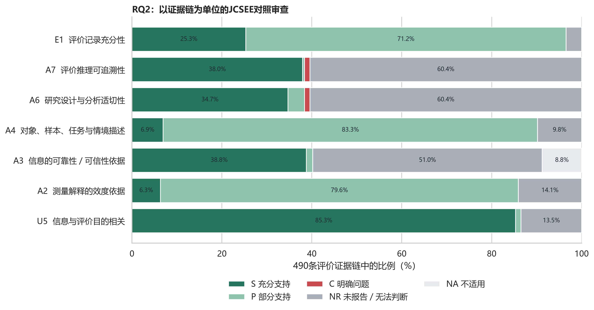
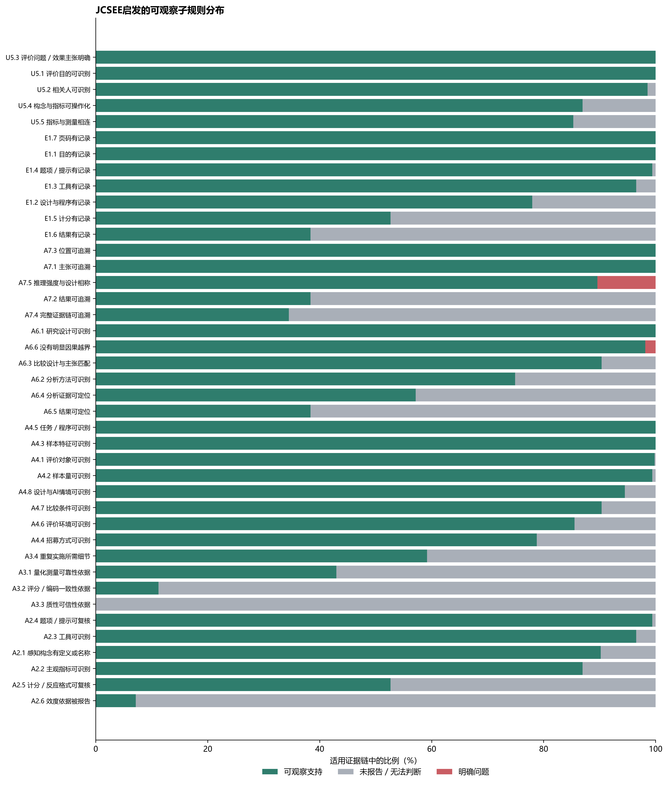

# RQ2：Perceived Effect 评价实践的规范性审查

基于JCSEE七项可观察标准的‘论文—评价案例—证据链’联合审查

整合日期：2026-10-27

# 1. 审查目标与性质

RQ2不把单条证据链的四个字段当作评价实践的全部信息，而是以每条证据链为审查单位，连接其所属评价案例和论文全文信息，形成‘一链一实践、三级信息供给’的完整评价实践链。审查对象共490条。

本研究使用JCSEE《项目评价标准》第三版中与公开论文所呈现的评价证据形成、测量质量、情境充分性、分析适切性、推理可追溯性和文档完整性直接相关的七项标准。结果应称为**JCSEE启发的公开报告规范性审查**，不是JCSEE官方认证，也不是对项目治理、资源、人权、利益冲突等30项标准的完整合规判定。

# 2. 为什么选择这七项

1. 与研究对象直接一致：本研究评价的是Perceived Effect证据如何形成，因此优先选择能检验目的相关性、效度、可靠性、情境、设计分析、推理和文档的条目。
2. 可以从公开论文判断：七项均能转化为正文、附录、题项、计分、样本、任务、分析和结果等可观察证据；需要访问组织内部治理或评价委托过程的条目不纳入最终筛选。
3. 覆盖从输入到结论的最短关键链：U5检验评价为何进行，A2/A3检验测量解释是否可信，A4检验适用范围，A6检验方法，A7检验结论推理，E1检验复核条件。
4. 服务RQ3的透明选样：七项能在不把‘未报告’误判为‘不规范’的前提下，把高置信、可用、描述性和明确问题证据分开。

# 3. 判定状态与信息连接

| 状态 | 含义 | 编码原则 |
| --- | --- | --- |
| S 充分支持 | 公开文本对该条目提供充分、可定位证据 | 证据必须能回到论文页码、案例字段或链字段 |
| P 部分支持 | 提供了部分关键信息，但不足以完整判断或复现 | 不等于不合格；表示报告充分性有限 |
| NR 未报告／无法判断 | 全文未提供足以判断的信息 | 不能解释为已证明不可靠或不规范 |
| C 明确问题 | 文本显示方法与主张不匹配、过度推断或明显冲突 | 进入EXCLUDE，不参与建模 |
| NA 不适用 | 该实践不需要对应程序 | 从适用项分母中排除 |

# 4. 七项标准的操作化规则

| 标准 | 核心问题 | 主要可观察数据 | 判定重点 |
| --- | --- | --- | --- |
| U5 信息与评价目的相关 | 证据是否回答明确目的和效果主张？ | 评价目的、主体／目标用户、主张、构念、指标、工具 | 目的—问题—测量是否连贯 |
| A2 测量解释的效度依据 | 测量是否支持拟作解释？ | 构念、指标、工具、题项、计分、效度／预测试／专家审查 | 内容与解释是否对应 |
| A3 可靠性／可信性依据 | 结果是否具有一致性或可信性？ | α/ω、ICC、重测、评分者一致性、饱和、三角互证、成员核查 | 按量化、评分、质性方法分别判断 |
| A4 对象、样本、任务与情境描述 | 证据适用于谁、什么对象和什么情境？ | 对象、样本量、样本特征、招募、任务、环境、比较条件、AI情境 | 是否足以判断适用范围 |
| A6 设计与分析适切性 | 方法是否足以回答主张？ | 研究设计、分析、比较条件、分析证据、结果、主张强度 | 比较／因果主张必须有相称设计 |
| A7 推理与结论可追溯 | 从主张到结论的路径是否可追溯？ | 主张引文、结果引文、页码、构念、指标、工具、分析 | 结论不超过证据支持范围 |
| E1 文档完整性 | 他人能否复核该评价实践？ | 目的、设计／程序、工具、题项、计分、结果、页码 | 记录完整性与定位性 |

## 4.1 41条可观察子规则及分布

七项标准进一步拆成41条可观察子规则，用于诊断究竟缺失在哪个环节；子规则不重新改变Q1/Q2/Q3的既定门槛。下表把S与P合并为‘有报告／可观察’，NR列为‘未报告’，C单列为‘明确问题’，NA按不适用保留。

| 标准 | 子规则 | 名称 | 有报告／可观察 | 未报告 | C | NA | 可观察规则 |
| --- | --- | --- | --- | --- | --- | --- | --- |
| U5 | U5.1 | 评价目的可识别 | 490 (100.0%) | 0 (0.0%) | 0 | 0 | purposes至少有一个有效代码 |
| U5 | U5.2 | 相关人可识别 | 483 (98.6%) | 7 (1.4%) | 0 | 0 | 评价主体或目标用户至少一项可识别 |
| U5 | U5.3 | 评价问题／效果主张明确 | 490 (100.0%) | 0 (0.0%) | 0 | 0 | 有原文主张或可追溯主张摘要 |
| U5 | U5.4 | 构念与指标可操作化 | 426 (86.9%) | 64 (13.1%) | 0 | 0 | 构念存在且指标映射到既定代码 |
| U5 | U5.5 | 指标与测量相连 | 418 (85.3%) | 72 (14.7%) | 0 | 0 | 证据链至少有一个可判定M1–M5工具实例 |
| A2 | A2.1 | 感知构念有定义或名称 | 442 (90.2%) | 48 (9.8%) | 0 | 0 | construct_raw可定位 |
| A2 | A2.2 | 主观指标可识别 | 426 (86.9%) | 64 (13.1%) | 0 | 0 | indicator_raw存在且indicator_code有效 |
| A2 | A2.3 | 工具可识别 | 473 (96.5%) | 17 (3.5%) | 0 | 0 | instrument_raw存在且工具类别可判定 |
| A2 | A2.4 | 题项／提示可复核 | 487 (99.4%) | 3 (0.6%) | 0 | 0 | item_quote存在 |
| A2 | A2.5 | 计分／反应格式可复核 | 258 (52.7%) | 232 (47.3%) | 0 | 0 | response_scoring存在 |
| A2 | A2.6 | 效度依据被报告 | 35 (7.1%) | 455 (92.9%) | 0 | 0 | validity_evidence含效度、预测试、专家审查或验证信息 |
| A3 | A3.1 | 量化测量可靠性依据 | 119 (24.3%) | 158 (32.2%) | 0 | 0 | 量化工具报告alpha、ICC、重测或其他可靠性证据 |
| A3 | A3.2 | 评分／编码一致性依据 | 41 (8.4%) | 325 (66.3%) | 0 | 0 | 第三方评分或质性编码报告评分者／编码者一致性 |
| A3 | A3.3 | 质性可信性依据 | 0 (0.0%) | 130 (26.5%) | 0 | 0 | 定性工具报告饱和、三角互证、成员核查或双人编码 |
| A3 | A3.4 | 重复实施所需细节 | 290 (59.2%) | 200 (40.8%) | 0 | 0 | 有题项／提示且有计分说明，或使用可识别具名量表 |
| A4 | A4.1 | 评价对象可识别 | 489 (99.8%) | 1 (0.2%) | 0 | 0 | objects至少有一个有效代码 |
| A4 | A4.2 | 样本量可识别 | 487 (99.4%) | 3 (0.6%) | 0 | 0 | sample_n有有效值 |
| A4 | A4.3 | 样本特征可识别 | 490 (100.0%) | 0 (0.0%) | 0 | 0 | sample_description有有效值 |
| A4 | A4.4 | 招募方式可识别 | 386 (78.8%) | 104 (21.2%) | 0 | 0 | recruitment有有效值 |
| A4 | A4.5 | 任务／程序可识别 | 490 (100.0%) | 0 (0.0%) | 0 | 0 | task或procedure至少一项存在 |
| A4 | A4.6 | 评价环境可识别 | 419 (85.5%) | 71 (14.5%) | 0 | 0 | setting有有效代码 |
| A4 | A4.7 | 比较条件可识别 | 103 (21.0%) | 11 (2.2%) | 0 | 0 | 比较／因果主张时comparator存在；其他主张NA |
| A4 | A4.8 | 设计与AI情境可识别 | 463 (94.5%) | 27 (5.5%) | 0 | 0 | 设计领域、阶段及AI功能／角色均可识别 |
| A6 | A6.1 | 研究设计可识别 | 490 (100.0%) | 0 (0.0%) | 0 | 0 | design至少有一个有效代码 |
| A6 | A6.2 | 分析方法可识别 | 367 (74.9%) | 123 (25.1%) | 0 | 0 | analysis字段报告分析程序 |
| A6 | A6.3 | 比较设计与主张匹配 | 103 (21.0%) | 11 (2.2%) | 0 | 0 | C2/C3主张有比较条件；其他主张NA |
| A6 | A6.4 | 分析证据可定位 | 280 (57.1%) | 210 (42.9%) | 0 | 0 | 报告统计检验、回归、混合模型、质性分析或置信区间等 |
| A6 | A6.5 | 结果可定位 | 188 (38.4%) | 302 (61.6%) | 0 | 0 | result_quote存在 |
| A6 | A6.6 | 没有明显因果越界 | 481 (98.2%) | 0 (0.0%) | 9 | 0 | 明确因果主张同时具有比较条件和分析证据；非因果主张通过 |
| A7 | A7.1 | 主张可追溯 | 490 (100.0%) | 0 (0.0%) | 0 | 0 | claim_quote或claim_summary存在 |
| A7 | A7.2 | 结果可追溯 | 188 (38.4%) | 302 (61.6%) | 0 | 0 | result_quote存在 |
| A7 | A7.3 | 位置可追溯 | 490 (100.0%) | 0 (0.0%) | 0 | 0 | pages存在 |
| A7 | A7.4 | 完整证据链可追溯 | 169 (34.5%) | 321 (65.5%) | 0 | 0 | 主张、构念、指标、工具、结果均存在 |
| A7 | A7.5 | 推理强度与设计相称 | 439 (89.6%) | 0 (0.0%) | 51 | 0 | C2/C3具有比较／分析支持，其他类型通过 |
| E1 | E1.1 | 目的有记录 | 490 (100.0%) | 0 (0.0%) | 0 | 0 | purposes存在 |
| E1 | E1.2 | 设计与程序有记录 | 382 (78.0%) | 108 (22.0%) | 0 | 0 | design与procedure存在 |
| E1 | E1.3 | 工具有记录 | 473 (96.5%) | 17 (3.5%) | 0 | 0 | instrument_raw存在且工具类别可判定 |
| E1 | E1.4 | 题项／提示有记录 | 487 (99.4%) | 3 (0.6%) | 0 | 0 | item_quote存在 |
| E1 | E1.5 | 计分有记录 | 258 (52.7%) | 232 (47.3%) | 0 | 0 | response_scoring存在 |
| E1 | E1.6 | 结果有记录 | 188 (38.4%) | 302 (61.6%) | 0 | 0 | result_quote存在 |
| E1 | E1.7 | 页码有记录 | 490 (100.0%) | 0 (0.0%) | 0 | 0 | pages存在 |

# 5. 标准层结果

| 标准 | 名称 | S | P | NR | C | NA |
| --- | --- | --- | --- | --- | --- | --- |
| U5 | 信息与评价目的相关 | 418 | 6 | 66 | 0 | 0 |
| A2 | 测量解释的效度依据 | 31 | 390 | 69 | 0 | 0 |
| A3 | 信息的可靠性／可信性依据 | 190 | 7 | 250 | 0 | 0 |
| A4 | 对象、样本、任务与情境描述 | 34 | 408 | 48 | 0 | 0 |
| A6 | 研究设计与分析适切性 | 170 | 18 | 296 | 6 | 0 |
| A7 | 评价推理与结论可追溯 | 186 | 2 | 296 | 6 | 0 |
| E1 | 评价文档完整性 | 124 | 349 | 17 | 0 | 0 |

*图1  490条评价实践在七项标准上的判定分布*

### 图1对应数据表

单元格为评价实践数n（占490条候选评价实践的百分比）。

| 标准 | 名称 | S | P | NR | C | NA |
| --- | --- | --- | --- | --- | --- | --- |
| U5 | 信息与评价目的相关 | 418 (85.3%) | 6 (1.2%) | 66 (13.5%) | 0 (0.0%) | 0 (0.0%) |
| A2 | 测量解释的效度依据 | 31 (6.3%) | 390 (79.6%) | 69 (14.1%) | 0 (0.0%) | 0 (0.0%) |
| A3 | 信息的可靠性／可信性依据 | 190 (38.8%) | 7 (1.4%) | 250 (51.0%) | 0 (0.0%) | 0 (0.0%) |
| A4 | 对象、样本、任务与情境描述 | 34 (6.9%) | 408 (83.3%) | 48 (9.8%) | 0 (0.0%) | 0 (0.0%) |
| A6 | 研究设计与分析适切性 | 170 (34.7%) | 18 (3.7%) | 296 (60.4%) | 6 (1.2%) | 0 (0.0%) |
| A7 | 评价推理与结论可追溯 | 186 (38.0%) | 2 (0.4%) | 296 (60.4%) | 6 (1.2%) | 0 (0.0%) |
| E1 | 评价文档完整性 | 124 (25.3%) | 349 (71.2%) | 17 (3.5%) | 0 (0.0%) | 0 (0.0%) |

最突出的问题不是评价活动完全缺失，而是关键测量与推理信息经常只得到部分支持或未报告。子规则诊断显示：质性可信性程序0/130；效度依据35/490（7.1%）；评分／编码一致性41/366（11.2%）；完整证据链可追溯169/490（34.5%）；结果可定位188/490（38.4%）；量化可靠性依据119/277（43.0%）；计分／反应格式258/490（52.7%）。

*图2  七项标准下41条子规则的报告分布*

### 图2对应数据表

S/P/NR/C的百分比以该子规则适用评价实践数为分母；NA不进入适用分母。

| 标准 | 子规则 | 名称 | 适用分母 | S | P | NR | C | NA |
| --- | --- | --- | --- | --- | --- | --- | --- | --- |
| U5 | U5.1 | 评价目的可识别 | 490 | 490 (100.0%) | 0 (0.0%) | 0 (0.0%) | 0 (0.0%) | 0 |
| U5 | U5.2 | 相关人可识别 | 490 | 483 (98.6%) | 0 (0.0%) | 7 (1.4%) | 0 (0.0%) | 0 |
| U5 | U5.3 | 评价问题／效果主张明确 | 490 | 490 (100.0%) | 0 (0.0%) | 0 (0.0%) | 0 (0.0%) | 0 |
| U5 | U5.4 | 构念与指标可操作化 | 490 | 426 (86.9%) | 0 (0.0%) | 64 (13.1%) | 0 (0.0%) | 0 |
| U5 | U5.5 | 指标与测量相连 | 490 | 418 (85.3%) | 0 (0.0%) | 72 (14.7%) | 0 (0.0%) | 0 |
| A2 | A2.1 | 感知构念有定义或名称 | 490 | 442 (90.2%) | 0 (0.0%) | 48 (9.8%) | 0 (0.0%) | 0 |
| A2 | A2.2 | 主观指标可识别 | 490 | 426 (86.9%) | 0 (0.0%) | 64 (13.1%) | 0 (0.0%) | 0 |
| A2 | A2.3 | 工具可识别 | 490 | 473 (96.5%) | 0 (0.0%) | 17 (3.5%) | 0 (0.0%) | 0 |
| A2 | A2.4 | 题项／提示可复核 | 490 | 487 (99.4%) | 0 (0.0%) | 3 (0.6%) | 0 (0.0%) | 0 |
| A2 | A2.5 | 计分／反应格式可复核 | 490 | 258 (52.7%) | 0 (0.0%) | 232 (47.3%) | 0 (0.0%) | 0 |
| A2 | A2.6 | 效度依据被报告 | 490 | 35 (7.1%) | 0 (0.0%) | 455 (92.9%) | 0 (0.0%) | 0 |
| A3 | A3.1 | 量化测量可靠性依据 | 277 | 119 (43.0%) | 0 (0.0%) | 158 (57.0%) | 0 (0.0%) | 0 |
| A3 | A3.2 | 评分／编码一致性依据 | 366 | 41 (11.2%) | 0 (0.0%) | 325 (88.8%) | 0 (0.0%) | 0 |
| A3 | A3.3 | 质性可信性依据 | 130 | 0 (0.0%) | 0 (0.0%) | 130 (100.0%) | 0 (0.0%) | 0 |
| A3 | A3.4 | 重复实施所需细节 | 490 | 290 (59.2%) | 0 (0.0%) | 200 (40.8%) | 0 (0.0%) | 0 |
| A4 | A4.1 | 评价对象可识别 | 490 | 489 (99.8%) | 0 (0.0%) | 1 (0.2%) | 0 (0.0%) | 0 |
| A4 | A4.2 | 样本量可识别 | 490 | 487 (99.4%) | 0 (0.0%) | 3 (0.6%) | 0 (0.0%) | 0 |
| A4 | A4.3 | 样本特征可识别 | 490 | 490 (100.0%) | 0 (0.0%) | 0 (0.0%) | 0 (0.0%) | 0 |
| A4 | A4.4 | 招募方式可识别 | 490 | 386 (78.8%) | 0 (0.0%) | 104 (21.2%) | 0 (0.0%) | 0 |
| A4 | A4.5 | 任务／程序可识别 | 490 | 490 (100.0%) | 0 (0.0%) | 0 (0.0%) | 0 (0.0%) | 0 |
| A4 | A4.6 | 评价环境可识别 | 490 | 419 (85.5%) | 0 (0.0%) | 71 (14.5%) | 0 (0.0%) | 0 |
| A4 | A4.7 | 比较条件可识别 | 114 | 103 (90.4%) | 0 (0.0%) | 11 (9.6%) | 0 (0.0%) | 0 |
| A4 | A4.8 | 设计与AI情境可识别 | 490 | 463 (94.5%) | 0 (0.0%) | 27 (5.5%) | 0 (0.0%) | 0 |
| A6 | A6.1 | 研究设计可识别 | 490 | 490 (100.0%) | 0 (0.0%) | 0 (0.0%) | 0 (0.0%) | 0 |
| A6 | A6.2 | 分析方法可识别 | 490 | 367 (74.9%) | 0 (0.0%) | 123 (25.1%) | 0 (0.0%) | 0 |
| A6 | A6.3 | 比较设计与主张匹配 | 114 | 103 (90.4%) | 0 (0.0%) | 11 (9.6%) | 0 (0.0%) | 0 |
| A6 | A6.4 | 分析证据可定位 | 490 | 280 (57.1%) | 0 (0.0%) | 210 (42.9%) | 0 (0.0%) | 0 |
| A6 | A6.5 | 结果可定位 | 490 | 188 (38.4%) | 0 (0.0%) | 302 (61.6%) | 0 (0.0%) | 0 |
| A6 | A6.6 | 没有明显因果越界 | 490 | 481 (98.2%) | 0 (0.0%) | 0 (0.0%) | 9 (1.8%) | 0 |
| A7 | A7.1 | 主张可追溯 | 490 | 490 (100.0%) | 0 (0.0%) | 0 (0.0%) | 0 (0.0%) | 0 |
| A7 | A7.2 | 结果可追溯 | 490 | 188 (38.4%) | 0 (0.0%) | 302 (61.6%) | 0 (0.0%) | 0 |
| A7 | A7.3 | 位置可追溯 | 490 | 490 (100.0%) | 0 (0.0%) | 0 (0.0%) | 0 (0.0%) | 0 |
| A7 | A7.4 | 完整证据链可追溯 | 490 | 169 (34.5%) | 0 (0.0%) | 321 (65.5%) | 0 (0.0%) | 0 |
| A7 | A7.5 | 推理强度与设计相称 | 490 | 439 (89.6%) | 0 (0.0%) | 0 (0.0%) | 51 (10.4%) | 0 |
| E1 | E1.1 | 目的有记录 | 490 | 490 (100.0%) | 0 (0.0%) | 0 (0.0%) | 0 (0.0%) | 0 |
| E1 | E1.2 | 设计与程序有记录 | 490 | 382 (78.0%) | 0 (0.0%) | 108 (22.0%) | 0 (0.0%) | 0 |
| E1 | E1.3 | 工具有记录 | 490 | 473 (96.5%) | 0 (0.0%) | 17 (3.5%) | 0 (0.0%) | 0 |
| E1 | E1.4 | 题项／提示有记录 | 490 | 487 (99.4%) | 0 (0.0%) | 3 (0.6%) | 0 (0.0%) | 0 |
| E1 | E1.5 | 计分有记录 | 490 | 258 (52.7%) | 0 (0.0%) | 232 (47.3%) | 0 (0.0%) | 0 |
| E1 | E1.6 | 结果有记录 | 490 | 188 (38.4%) | 0 (0.0%) | 302 (61.6%) | 0 (0.0%) | 0 |
| E1 | E1.7 | 页码有记录 | 490 | 490 (100.0%) | 0 (0.0%) | 0 (0.0%) | 0 (0.0%) | 0 |

# 6. 研究用途质量层级

| 层级 | 判定规则 | 数量 | 比例 | 研究用途 |
| --- | --- | --- | --- | --- |
| Q1 高置信 | 无C；U5/A2/A6/A7均S；A3为S或NA；A4/E1为S或P | 6 | 1.2% | 高置信实例与严格验证 |
| Q2 可用 | 无C；U5/A2/A4/A6/A7/E1均S或P；A3为S/P/NA | 42 | 8.6% | 与Q1合并为主要规范集 |
| Q3 描述／扩展 | 未达到Q1/Q2；其中107条满足扩展集规则 | 436 | 89.0% | 描述统计；符合扩展规则者进入模型开发 |
| EXCLUDE | 至少一项为C | 6 | 1.2% | 不进入RQ3 |

**主要规范集**为Q1+Q2，共48条。**扩展规范集**共155条，要求U5、A2、A4、A6、A7和E1至少达到S或P、所有标准均不得为C，唯一放宽是A3可以为NR。A3=NR表示可靠性／质性可信性依据未报告，不能解释为已证明可靠。

30项全文重审曾显示若把所有JCSEE条目同时作为严格合规门槛，只剩2条记录，无法支持RQ3。最终七项方案不是按‘重要性排名’任意删减，而是依据研究对象相关性、公开文本可观察性和建模用途构造的最小关键集；未纳入的项目治理与组织过程标准仍可作为方法学讨论和未来前瞻性研究的质量框架。

# 7. 结论与改进重点

1. 优先补齐效度依据、信度／可信性程序和评分者一致性，而不仅仅报告工具名称。
2. 明确题项、量尺端点、聚合与计分规则，使分数解释可复核。
3. 对比较性、改善性或因果性效果主张报告相称的对照、分析和不确定性。
4. 在结果处保留原文引文和页码，使主张—构念—指标—工具—结果链可追溯。
5. 推荐系统必须显示证据层级；主要规范集不足时，回退扩展规范集但显式标记不确定性。
