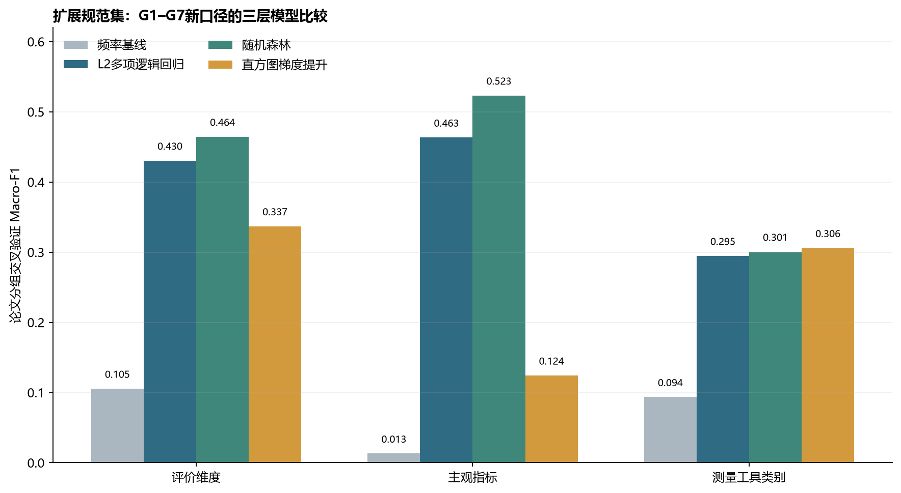
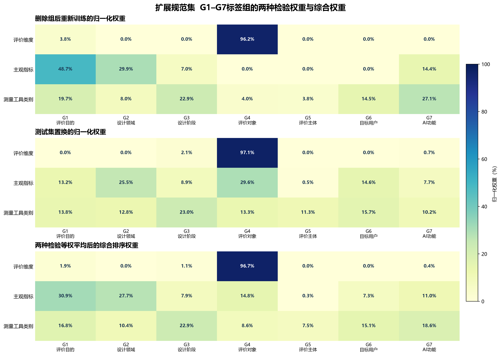
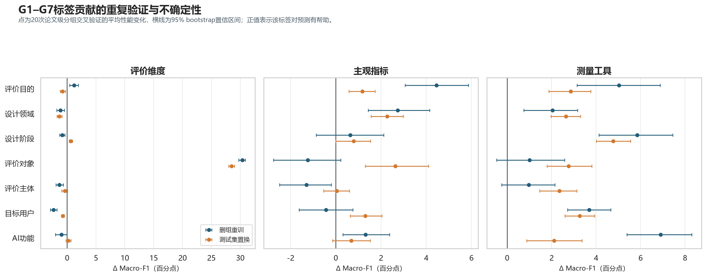
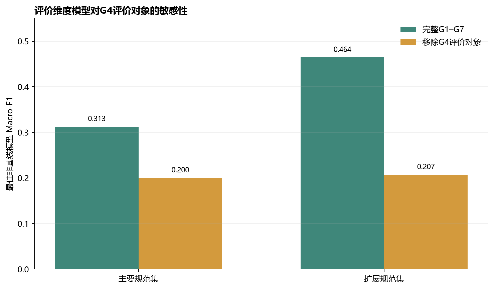

# RQ3：情景标签与评价证据选择的关联建模

主要规范集与扩展规范集的三层预测、稳健性检验和标签权重

整合日期：2026-10-27

# 1. 研究目标

RQ3检验：设计师对评价任务所定义的情景标签，能在多大程度上帮助推荐评价维度、主观指标和测量工具。最终输入只保留G1–G7，不再使用旧模型中的效果主张形式、数据源、评价环境、可行性约束、AI角色或任务标签。

| 标签组 | 代码及类别 |
| --- | --- |
| G1 评价目的 | P1价值引出与标准建构；P2模型监督、校准与代理目标；P3形成性反馈与迭代引导；P4总结性验证与比较 |
| G2 设计领域 | D1视觉传播；D2工业／产品；D3时装；D4室内；D5服务；D6 UI/UX设计 |
| G3 设计阶段 | S1研究；S2构思；S3原型制作与测试；S4实施 |
| G4 评价对象 | O1设计成果或解决方案；O2设计任务或工作流程；O3 AI辅助设计系统或界面；O4人的状态或能力；O5人机协作关系 |
| G5 评价主体 | V1设计任务执行者；V2设计成果使用者；V3外部领域专家；V4一般公众／非目标人群；V5内部研究者／系统开发者 |
| G6 目标用户 | U1专业设计从业者；U2设计学习者／新手设计者；U3非专业创作者 |
| G7 AI功能 | F1识别需求；F2知识检索；F3方案生成；F4原型实现；F5评估反馈；F6迭代优化 |

G6只指直接使用AI辅助设计workflow的人。设计成果的受益者或终端用户不自动进入G6；只有其实际作出评价判断时才作为G5评价主体编码。

# 2. 分析集与n的定义

| 分析集／目标 | n | 论文数 | 类别数 | n的含义 |
| --- | --- | --- | --- | --- |
| 主要规范集—评价维度 | 46 | 20 | 4 | 48条主要链中，满足类别最小支持阈值的链级观测 |
| 主要规范集—主观指标 | 6 | 5 | 1 | 仅A1达到≥5条且≥3篇论文；不能多分类建模 |
| 主要规范集—测量工具 | 53 | 21 | 4 | 54个主要工具实例中满足工具类别支持阈值的实例 |
| 扩展规范集—评价维度 | 155 | 38 | 5 | 链级观测 |
| 扩展规范集—主观指标 | 95 | 27 | 10 | 满足最小支持阈值的链级观测 |
| 扩展规范集—测量工具 | 182 | 38 | 5 | 工具实例级观测 |

最小支持阈值为：输出类别至少5个观测且来自至少3篇论文。评价维度和主观指标以证据链为观测单位；工具以测量工具实例为观测单位。

# 3. 三层建模与验证

1. 第一层：G1–G7情景标签 → 评价维度。
2. 第二层：情景标签＋已确定评价维度 → 主观指标。
3. 第三层：情景标签＋已确定评价维度和主观指标 → 测量工具类别。

比较模型包括频率基线、L2多项逻辑回归、随机森林和直方图梯度提升，以Macro-F1选择最佳非基线模型，并报告Top-2准确率。所有交叉验证按paper_id分组，避免同一论文中高度相似的任务、样本、题项或工具同时进入训练集和测试集。否则模型可能记住论文风格而不是学习可推广的情景—证据关系，测试分数会虚高。

# 4. 模型结果

## 4.1 主要规范集

| 推荐目标 | n | 论文数 | 类别数 | 最佳模型 | Macro-F1 | Top-2准确率 |
| --- | --- | --- | --- | --- | --- | --- |
| 评价维度 | 46 | 20 | 4 | 随机森林 | .313 | .858 |
| 主观指标 | 6 | 5 | 1 | 无法建模 | — | — |
| 测量工具类别 | 53 | 21 | 4 | L2多项逻辑回归 | .286 | .716 |

主要规范集的48条链并非只有6条有指标：其中47条有可映射指标，但分散在22类。应用最小支持阈值后，只有A1新颖性保留6条、5篇论文，因此无法建立主观指标多分类模型。

## 4.2 扩展规范集

| 推荐目标 | n | 论文数 | 类别数 | 最佳模型 | Macro-F1 | 频率基线 | Top-2准确率 |
| --- | --- | --- | --- | --- | --- | --- | --- |
| 评价维度 | 155 | 38 | 5 | 随机森林 | .464 | .105 | .836 |
| 主观指标 | 95 | 27 | 10 | 随机森林 | .523 | .013 | .808 |
| 测量工具类别 | 182 | 38 | 5 | 直方图梯度提升 | .306 | .094 | .630 |

三层模型均优于频率基线，但维度和工具模型仍不足以支持自动给出唯一答案。合理输出应是带证据量与不确定性的候选排序。

*图1  主要规范集与扩展规范集的候选模型比较*

### 图1对应数据表

图中柱高对应Macro-F1均值；频率基线及全部候选模型均列出。

| 分析集 | 推荐目标 | 模型 | n | 论文数 | 类别数 | 折数 | Macro-F1均值 | 标准差 | Top-2准确率 |
| --- | --- | --- | --- | --- | --- | --- | --- | --- | --- |
| 主要规范集 | 评价维度 | 频率基线 | 46 | 20 | 4 | 5 | 0.130 | 0.038 | — |
| 主要规范集 | 评价维度 | L2多项逻辑回归 | 46 | 20 | 4 | 5 | 0.299 | 0.067 | 0.768 |
| 主要规范集 | 评价维度 | 随机森林 | 46 | 20 | 4 | 5 | 0.313 | 0.189 | 0.858 |
| 主要规范集 | 评价维度 | 直方图梯度提升 | 46 | 20 | 4 | 5 | 0.130 | 0.038 | 0.537 |
| 主要规范集 | 测量工具类别 | 频率基线 | 53 | 21 | 4 | 4 | 0.136 | 0.029 | — |
| 主要规范集 | 测量工具类别 | L2多项逻辑回归 | 53 | 21 | 4 | 4 | 0.286 | 0.150 | 0.716 |
| 主要规范集 | 测量工具类别 | 随机森林 | 53 | 21 | 4 | 4 | 0.239 | 0.193 | 0.649 |
| 主要规范集 | 测量工具类别 | 直方图梯度提升 | 53 | 21 | 4 | 4 | 0.226 | 0.148 | 0.627 |
| 扩展规范集 | 评价维度 | 频率基线 | 155 | 38 | 5 | 5 | 0.105 | 0.014 | — |
| 扩展规范集 | 评价维度 | L2多项逻辑回归 | 155 | 38 | 5 | 5 | 0.430 | 0.145 | 0.740 |
| 扩展规范集 | 评价维度 | 随机森林 | 155 | 38 | 5 | 5 | 0.464 | 0.162 | 0.836 |
| 扩展规范集 | 评价维度 | 直方图梯度提升 | 155 | 38 | 5 | 5 | 0.337 | 0.065 | 0.675 |
| 扩展规范集 | 主观指标 | 频率基线 | 95 | 27 | 10 | 3 | 0.013 | 0.007 | — |
| 扩展规范集 | 主观指标 | L2多项逻辑回归 | 95 | 27 | 10 | 3 | 0.463 | 0.044 | 0.726 |
| 扩展规范集 | 主观指标 | 随机森林 | 95 | 27 | 10 | 3 | 0.523 | 0.046 | 0.808 |
| 扩展规范集 | 主观指标 | 直方图梯度提升 | 95 | 27 | 10 | 3 | 0.124 | 0.064 | 0.400 |
| 扩展规范集 | 测量工具类别 | 频率基线 | 182 | 38 | 5 | 5 | 0.094 | 0.012 | — |
| 扩展规范集 | 测量工具类别 | L2多项逻辑回归 | 182 | 38 | 5 | 5 | 0.295 | 0.045 | 0.641 |
| 扩展规范集 | 测量工具类别 | 随机森林 | 182 | 38 | 5 | 5 | 0.301 | 0.127 | 0.638 |
| 扩展规范集 | 测量工具类别 | 直方图梯度提升 | 182 | 38 | 5 | 5 | 0.306 | 0.108 | 0.630 |

# 5. 标签贡献、稳健性与综合排序权重

每层最佳模型在20次不同随机种子的论文级分组交叉验证中复算。标签贡献同时采用两种检验：①删除整个G组后重新训练；②在测试集置换整个G组。贡献定义为完整模型Macro-F1减去受扰动模型Macro-F1。只有两种方法的95% bootstrap置信区间都高于0，才视为双重稳健。综合排序权重是两种正向平均贡献各自归一化后等权平均，仅用于提问顺序和匹配排序，不代表因果或理论重要性。

| 推荐目标 | 综合排序权重 | 双重稳健标签 |
| --- | --- | --- |
| 评价维度 | G4 96.7%；G1 1.9%；G3 1.1%；G7 0.4%；其余0 | G4 |
| 主观指标 | G1 30.9%；G2 27.7%；G4 14.8%；G7 11.0%；G3 7.9%；G6 7.3%；G5 0.3% | G1、G2 |
| 测量工具 | G3 22.9%；G7 18.6%；G1 16.8%；G6 15.1%；G2 10.4%；G4 8.6%；G5 7.5% | G1、G2、G3、G6、G7 |

为使综合权重的形成过程可以直接复核，图2同时呈现删组重训权重、测试集置换权重和二者等权平均后的综合权重。每种方法均先把负贡献截为0，再在同一推荐目标内归一化为100%；综合权重为两套归一化权重的算术平均。

*图2  扩展规范集的删组重训权重、测试集置换权重与综合权重*

### 图2对应数据表

删组重训与测试集置换的正向平均贡献分别在同一推荐目标内归一化为100%；综合排序权重为两者等权平均，因此三套权重在各推荐目标内均合计100%。

| 推荐目标 | 标签组 | 删组重训权重 | 测试集置换权重 | 综合排序权重 | 双重稳健 | 进入核心界面 | 本层one-SE阈值 |
| --- | --- | --- | --- | --- | --- | --- | --- |
| 评价维度 | G1_评价目的 | 3.8% | 0.0% | 1.9% | 否 | 否 | 96.7% |
| 评价维度 | G2_设计领域 | 0.0% | 0.0% | 0.0% | 否 | 否 | 96.7% |
| 评价维度 | G3_设计阶段 | 0.0% | 2.1% | 1.1% | 否 | 否 | 96.7% |
| 评价维度 | G4_评价对象 | 96.2% | 97.1% | 96.7% | 是 | 是 | 96.7% |
| 评价维度 | G5_评价主体 | 0.0% | 0.0% | 0.0% | 否 | 否 | 96.7% |
| 评价维度 | G6_目标用户 | 0.0% | 0.0% | 0.0% | 否 | 否 | 96.7% |
| 评价维度 | G7_AI功能 | 0.0% | 0.7% | 0.4% | 否 | 否 | 96.7% |
| 主观指标 | G1_评价目的 | 48.7% | 13.2% | 30.9% | 是 | 是 | 27.7% |
| 主观指标 | G2_设计领域 | 29.9% | 25.5% | 27.7% | 是 | 是 | 27.7% |
| 主观指标 | G3_设计阶段 | 7.0% | 8.9% | 7.9% | 否 | 否 | 27.7% |
| 主观指标 | G4_评价对象 | 0.0% | 29.6% | 14.8% | 否 | 否 | 27.7% |
| 主观指标 | G5_评价主体 | 0.0% | 0.5% | 0.3% | 否 | 否 | 27.7% |
| 主观指标 | G6_目标用户 | 0.0% | 14.6% | 7.3% | 否 | 否 | 27.7% |
| 主观指标 | G7_AI功能 | 14.4% | 7.7% | 11.0% | 否 | 否 | 27.7% |
| 测量工具类别 | G1_评价目的 | 19.7% | 13.8% | 16.8% | 是 | 是 | 15.1% |
| 测量工具类别 | G2_设计领域 | 8.0% | 12.8% | 10.4% | 是 | 否 | 15.1% |
| 测量工具类别 | G3_设计阶段 | 22.9% | 23.0% | 22.9% | 是 | 是 | 15.1% |
| 测量工具类别 | G4_评价对象 | 4.0% | 13.3% | 8.6% | 否 | 否 | 15.1% |
| 测量工具类别 | G5_评价主体 | 3.8% | 11.3% | 7.5% | 否 | 否 | 15.1% |
| 测量工具类别 | G6_目标用户 | 14.5% | 15.7% | 15.1% | 是 | 是 | 15.1% |
| 测量工具类别 | G7_AI功能 | 27.1% | 10.2% | 18.6% | 是 | 是 | 15.1% |

*图3  删除重训与测试集置换的原始ΔMacro-F1及95%区间*

### 图3对应数据表

正值表示扰动该标签组后模型性能下降；两种95%区间均高于0才判为双重稳健。

| 推荐目标 | 标签组 | 删组ΔMacro-F1 | 删组95% CI | 置换ΔMacro-F1 | 置换95% CI | 双重稳健 |
| --- | --- | --- | --- | --- | --- | --- |
| 评价维度 | G1_评价目的 | 0.0121 | [0.0044, 0.0194] | -0.0079 | [-0.0123, -0.0030] | 否 |
| 评价维度 | G2_设计领域 | -0.0115 | [-0.0180, -0.0047] | -0.0134 | [-0.0176, -0.0087] | 否 |
| 评价维度 | G3_设计阶段 | -0.0086 | [-0.0130, -0.0037] | 0.0062 | [0.0034, 0.0094] | 否 |
| 评价维度 | G4_评价对象 | 0.3037 | [0.2973, 0.3089] | 0.2850 | [0.2800, 0.2900] | 是 |
| 评价维度 | G5_评价主体 | -0.0134 | [-0.0196, -0.0067] | -0.0041 | [-0.0091, 0.0008] | 否 |
| 评价维度 | G6_目标用户 | -0.0236 | [-0.0291, -0.0177] | -0.0073 | [-0.0096, -0.0047] | 否 |
| 评价维度 | G7_AI功能 | -0.0098 | [-0.0203, -0.0002] | 0.0021 | [-0.0021, 0.0067] | 否 |
| 主观指标 | G1_评价目的 | 0.0446 | [0.0306, 0.0587] | 0.0118 | [0.0058, 0.0174] | 是 |
| 主观指标 | G2_设计领域 | 0.0274 | [0.0143, 0.0415] | 0.0227 | [0.0157, 0.0298] | 是 |
| 主观指标 | G3_设计阶段 | 0.0064 | [-0.0087, 0.0212] | 0.0079 | [-0.0000, 0.0153] | 否 |
| 主观指标 | G4_评价对象 | -0.0124 | [-0.0276, 0.0022] | 0.0263 | [0.0131, 0.0410] | 否 |
| 主观指标 | G5_评价主体 | -0.0129 | [-0.0249, -0.0020] | 0.0005 | [-0.0054, 0.0060] | 否 |
| 主观指标 | G6_目标用户 | -0.0043 | [-0.0162, 0.0076] | 0.0130 | [0.0064, 0.0204] | 否 |
| 主观指标 | G7_AI功能 | 0.0132 | [0.0031, 0.0238] | 0.0068 | [-0.0014, 0.0153] | 否 |
| 测量工具类别 | G1_评价目的 | 0.0503 | [0.0314, 0.0689] | 0.0286 | [0.0188, 0.0376] | 是 |
| 测量工具类别 | G2_设计领域 | 0.0205 | [0.0075, 0.0317] | 0.0265 | [0.0197, 0.0330] | 是 |
| 测量工具类别 | G3_设计阶段 | 0.0585 | [0.0413, 0.0746] | 0.0477 | [0.0401, 0.0556] | 是 |
| 测量工具类别 | G4_评价对象 | 0.0101 | [-0.0047, 0.0259] | 0.0276 | [0.0179, 0.0381] | 否 |
| 测量工具类别 | G5_评价主体 | 0.0097 | [-0.0024, 0.0215] | 0.0235 | [0.0146, 0.0313] | 否 |
| 测量工具类别 | G6_目标用户 | 0.0369 | [0.0271, 0.0466] | 0.0327 | [0.0260, 0.0395] | 是 |
| 测量工具类别 | G7_AI功能 | 0.0690 | [0.0538, 0.0830] | 0.0212 | [0.0088, 0.0337] | 是 |

## 5.1 对旧图100%结果的更正

旧图‘主观指标—G6目标用户100%’来自一次交叉验证中把负贡献截为0后仅剩一个极小正值（ΔMacro-F1=.019），再做行归一化的数学结果；其95%区间[-.008,.065]跨0。重复验证后，G6删组均值为-.004，结论不稳健。因此撤回100%解释，主观指标层的稳定信号为G1评价目的和G2设计领域。

## 5.2 G4的语义重叠敏感性

G4评价对象与评价维度在概念上可能部分重叠。移除G4后，主要规范集维度模型Macro-F1由.313降至.200，扩展规范集由.464降至.207；重复审计的删组贡献约30.4个百分点、置换贡献约28.5个百分点。G4是强预测信号，但应解释为用于路由维度的情景标签，不能据此宣称其对Perceived Effect具有因果作用。

*图4  评价维度模型移除G4后的敏感性结果*

### 图4对应数据表

柱高为论文分组交叉验证的Macro-F1均值。

| 分析集 | 最佳模型 | 完整G1–G7 Macro-F1 | 移除G4 Macro-F1 | 下降值 |
| --- | --- | --- | --- | --- |
| 主要规范集 | 随机森林 | 0.313 | 0.200 | 0.113 |
| 扩展规范集 | 随机森林 | 0.464 | 0.207 | 0.257 |

# 6. RQ3结论

- 评价维度主要由评价对象帮助路由；评价目的和设计领域主要帮助细化主观指标。
- 测量工具更依赖实施条件：设计阶段、AI功能、评价目的和目标用户共同提供稳定信息。
- 主要规范集用于严格验证，但样本过小；扩展规范集用于模型开发和推荐，必须同时显示证据等级。
- 模型输出应为候选排序、支持论文数、工具实例数和可追溯证据，不应伪装为唯一正确选择。
