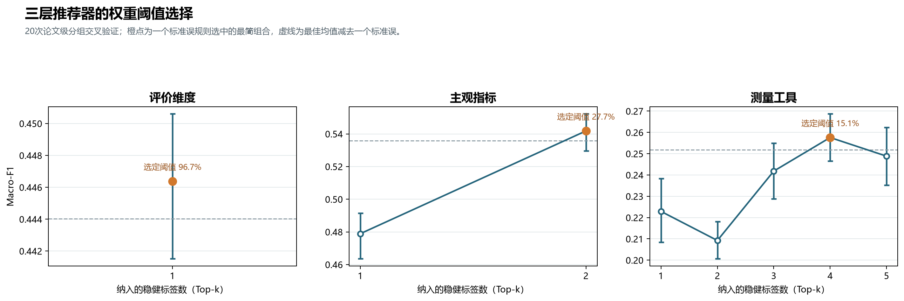

# RQ4：分层推荐阈值与渐进式推荐规则

基于RQ3双重稳健标签、20次论文分组交叉验证和one-standard-error规则

整合日期：2026-10-27

# 1. 为什么每层单独确定阈值

评价维度、主观指标和测量工具是三个不同难度、不同样本量和不同标签贡献结构的预测任务。统一使用15%会忽略这些差异。最终做法是先限定为通过删组重训与测试集置换双重稳健检验的标签，再按综合排序权重由高到低构造Top-1至Top-k组合，并用20次论文级分组交叉验证比较Macro-F1。

选择规则为：取标签数量最少、且平均Macro-F1不低于‘最佳组合平均Macro-F1－最佳组合标准误’的组合。该组合中最低的综合排序权重即为该层阈值。这是one-standard-error规则，用较少标签换取与最佳模型统计上接近的性能。

# 2. 最终阈值

| 推荐层 | 最佳阈值 | 进入界面的核心标签 | Macro-F1 | Top-2准确率 |
| --- | --- | --- | --- | --- |
| 评价维度 | 96.7% | G4 评价对象 | .446 | .760 |
| 主观指标 | 27.7% | G1 评价目的；G2 设计领域 | .542 | .824 |
| 测量工具 | 15.1% | G3 设计阶段；G7 AI功能；G1 评价目的；G6 目标用户 | .258 | .561 |

*图1  三个推荐层的Top-k组合、标准误界线与最终阈值*

### 图1对应数据表

每行对应图中的一个Top-k组合；阈值是该组合中最低的综合排序权重。

| 推荐层 | Top-k | 纳入标签组 | 候选阈值 | Macro-F1均值 | 标准误 | 95% CI | Top-2准确率 | one-SE界线 | 最终选中 |
| --- | --- | --- | --- | --- | --- | --- | --- | --- | --- |
| 评价维度 | 1 | G4_评价对象 | 96.7% | 0.446 | 0.002 | [0.442, 0.451] | 0.760 | 0.444 | 是 |
| 主观指标 | 1 | G1_评价目的 | 30.9% | 0.479 | 0.007 | [0.464, 0.491] | 0.793 | 0.536 | 否 |
| 主观指标 | 2 | G1_评价目的;G2_设计领域 | 27.7% | 0.542 | 0.006 | [0.530, 0.552] | 0.824 | 0.536 | 是 |
| 测量工具类别 | 1 | G3_设计阶段 | 22.9% | 0.223 | 0.008 | [0.208, 0.238] | 0.571 | 0.252 | 否 |
| 测量工具类别 | 2 | G3_设计阶段;G7_AI功能 | 18.6% | 0.209 | 0.005 | [0.201, 0.218] | 0.556 | 0.252 | 否 |
| 测量工具类别 | 3 | G3_设计阶段;G7_AI功能;G1_评价目的 | 16.8% | 0.242 | 0.007 | [0.229, 0.255] | 0.597 | 0.252 | 否 |
| 测量工具类别 | 4 | G3_设计阶段;G7_AI功能;G1_评价目的;G6_目标用户 | 15.1% | 0.258 | 0.006 | [0.247, 0.269] | 0.561 | 0.252 | 是 |
| 测量工具类别 | 5 | G3_设计阶段;G7_AI功能;G1_评价目的;G6_目标用户;G2_设计领域 | 10.4% | 0.249 | 0.007 | [0.235, 0.262] | 0.545 | 0.252 | 否 |

## 2.1 评价维度层

只有G4通过双重稳健检验，因此该层没有多个候选标签组合竞争。96.7%是当前数据结构下的结构性阈值，不应外推为通用分界线。推荐器只让用户定义评价对象。

## 2.2 主观指标层

仅G1时Macro-F1=.479，加入G2后升至.542，因此保留评价目的和设计领域。此层在用户确认评价维度后再披露。

## 2.3 测量工具层

G3+G7+G1+G6的Top-4组合达到最高Macro-F1=.258。加入权重10.4%的G2后降至.249，并低于one-SE界线.252，因此核心标签止于G6，对应最低权重15.1%。

# 3. 最终渐进式披露流程

1. 第一层——推荐评价维度：只询问G4评价对象；输出A–E候选维度、支持证据量和不确定性。用户确认一个维度后才进入第二层。
2. 第二层——推荐主观指标：在已确认维度的条件下，只询问G1评价目的和G2设计领域；输出该维度下的二级指标候选。用户确认指标后进入第三层。
3. 第三层——推荐测量工具：在已确认维度和指标的条件下，只询问G3设计阶段、G7 AI功能、G1评价目的和G6目标用户；输出M1–M5类别、可追溯具体工具和使用证据。

| 推荐层 | 用户需要定义 | 不显示／不参与后台匹配 | 已确认的上层条件 |
| --- | --- | --- | --- |
| 评价维度 | G4 | G1、G2、G3、G5、G6、G7 | 无 |
| 主观指标 | G1、G2 | G3、G4、G5、G6、G7 | 评价维度 |
| 测量工具 | G3、G7、G1、G6 | G2、G4、G5 | 评价维度＋主观指标 |

# 4. 推荐、回退与证据显示规则

1. 默认先检索主要规范集（48条）；本层候选不足时回退扩展规范集（155条），界面必须标明回退。
2. 低于该层阈值或未通过双重稳健检验的标签不在条件定义界面显示，也不在后台参与匹配与排序；只保留在研究报告中作为敏感性结果。
3. 推荐项同时显示支持论文数、证据链数；工具层另显示工具实例数、具体工具名称、题项／计分信息和页码。
4. 当当前标签组合没有足够证据时，返回‘证据不足’，允许用户减少条件，但不能用低质量记录填充出虚假的确定答案。
5. Top-2结果优先于唯一答案；排名是证据支持度和模型匹配度，不是工具效度的替代证明。

# 5. 推荐器政策摘要

| 层 | 核心输入 | 阈值 | 严格实现 |
| --- | --- | --- | --- |
| 维度 | G4 | 96.7% | 只按评价对象路由 |
| 指标 | G1+G2 | 27.7% | 确认维度后，按目的与领域排序 |
| 工具 | G3+G7+G1+G6 | 15.1% | 确认维度和指标后，按阶段、功能、目的、目标用户排序 |

这一政策对应当前网站的最终正确状态。阈值由现有125篇语料内部估计，未来语料扩充或分类体系改变后应重新训练和重新校准。
